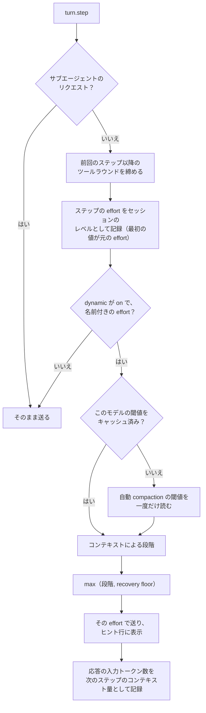
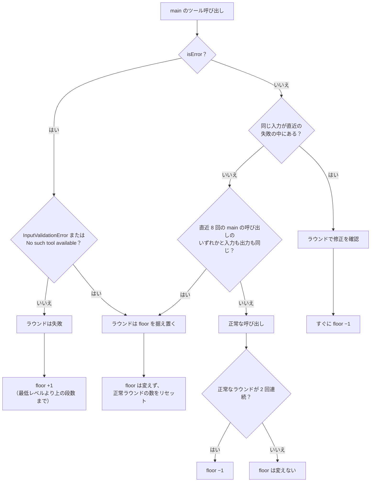
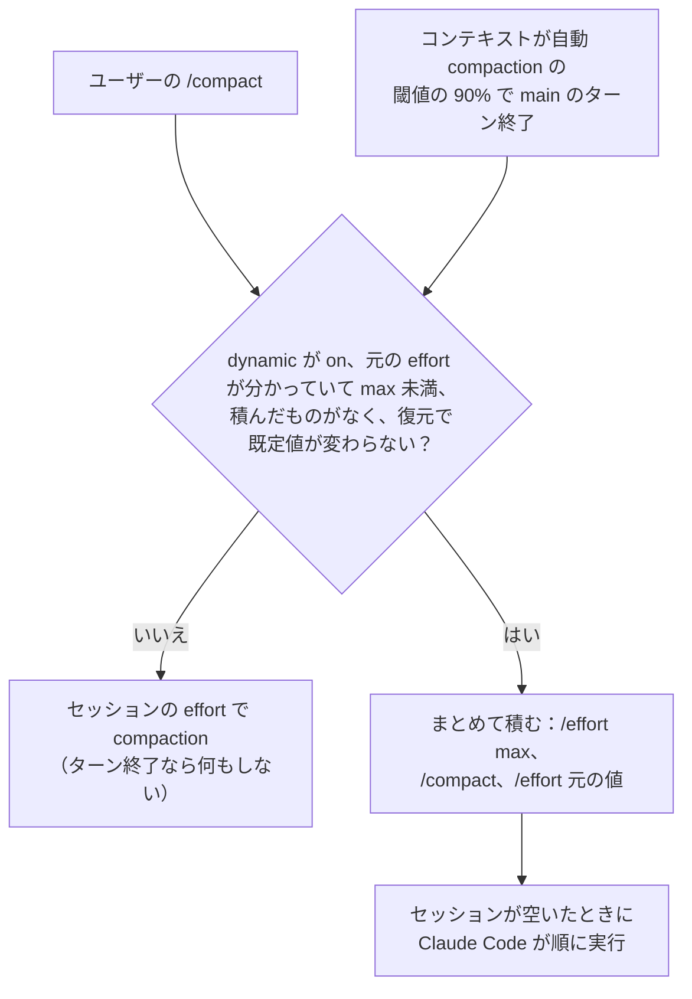

# Claude dynamic effort

[English](README.md)

セッション中に得られた根拠から、main スレッドのモデルリクエストごとの推論 effort を選ぶ
Claude Code の mod です。`tools/pi-effort-manager` の dynamic work-effort 部分の移植から始まり、
下記の研究をもとに再設計しました。

- main のリクエストは、コンテキストによる段階と、ツールの失敗で上がる recovery floor の高いほうで
  送ります。レベルは選べる最低値（既定は `low`）から `xhigh` までです。
- 繰り返しや不正な呼び出しは floor を据え置き、修正が確認できればすぐ 1 段下げ、正常なラウンドが
  2 回続けば 1 段下げます。上限で 3 ラウンド続けて失敗すると、失敗した結果に、方針を変えるよう促す
  注記を 1 回だけ付けます。
- Claude Code 自身の compaction は `max` で実行し、やめた方法を残す指示を 1 つ追加します。
  セッションの effort を上げるのはその compaction の間だけなので、サブエージェントや補助的な
  リクエストは元の effort のままです。
- `/dynamic-effort on|off|status` で、現在のセッションでの動作を切り替えます。新しいセッションは
  on で始まり、再開したセッションは前の on/off を引き継ぎます。

## effort を dynamic にする理由

effort を固定すると、どちらかの妥協になります。最も難しいステップに合わせて高くすれば、定型的な
ステップで推論（と時間）が無駄になり、定型的なステップに合わせて低くすれば、難しいステップで
失敗します。ステップごとに effort を選べば、この両方を避けられます。以下のメリットは引用した研究の
結果であり、このパッケージ自体をタスクのベンチマークで測ったものではありません。

- **必要なところで精度を確保できる。** 誤りの修正や計画の練り直しのステップには高い effort が必要で、
  全ステップを low effort で動かすと精度が落ちました[^ares]。
- **同じ結果をより少ない推論で得られる。** ステップごとに effort を選ぶと、固定の high effort と
  同等以上の精度で、推論トークンを最大 52.7% 削減できました[^ares]。難易度に応じて推論の計算量を
  配分すると、best-of-N と比べて 4 倍以上効率的になり[^snell]、考えるかどうかを学習させると応答長を
  53% 減らしつつ精度が 2.4% 上がりました[^adaptthink]。
- **考えすぎを減らせる。** 推論が多いほど、解決できたエージェントのタスクが少ない傾向があり
  [^overthinking]、推論モデルは簡単な問題に過剰な計算資源を割き[^chen]、推論を長くすると精度が
  下がることもあります[^inverse]。
- **長いセッションでも崩れにくい。** コンテキストが長くなるほど精度が落ちるため[^contextrot]、
  最初のステップから均等に使うのではなく、コンテキストに応じて effort を上げます。
- **定型的なステップが速くなる。** 定型的なステップは固定の高いレベルではなく最低レベルで動くので、
  ツール呼び出しの間の待ち時間が短くなります。

## effort の決め方

`turn.step` フックが、main のリクエストごとに送信前の `effort` を書き換えます。サブエージェントの
リクエスト、effort を持たないモデル、数値（budget）で指定された effort はそのまま送ります。



**コンテキストによる段階。** コンテキスト量は、直前の main の応答の入力側
（`input + cache_read + cache_creation` トークン）で、status line と同じ数え方です。
自動 compaction の閾値の 60% までは最低レベルで、残りの範囲を、その上の `xhigh` までのレベルに
等分します。既定の `low` なら、約 60〜73% が `medium`、73〜87% が `high`、それを超えると `xhigh` です。閾値は、
Claude Code のローカルの推定値からモデルごとに一度だけ読みます。

**最低レベル。** プラグインの `minEffort` オプション（設定メニューの選択肢：`low`、`medium`、`high`、
`xhigh`）で最低レベルを決めます。不明な値は `low` として扱います。既定は `low` で、普段のステップは
いちばん安く始め、コンテキストと失敗に応じて上げます。精度が落ちるなら `medium` を選んでください。
トークンの予算が小さすぎると、かえって多くのトークンを使うことがあり（token elasticity）[^tale]、
全ステップを low にすると精度が落ちるためです[^ares]。

**手動での変更。** ユーザー自身が `/effort <レベル>` を実行すると、そのレベルがこのセッションの最低値に
なり、コンテキストによる段階と recovery floor はそこから上がります。`/effort max` なら main のステップは
すべて `max`、`/effort auto` で設定した最低値に戻り、再びコンテキストによる段階と recovery floor でレベルが決まります。
新しいセッション、再開したセッション（`claude --resume` やプロセス内の `/resume`）、`/clear`、fork も、
設定した最低値から始まり、それぞれのコンテキスト量に応じて上がります。

**送る effort。** コンテキストによる段階と recovery floor の高いほうで、ユーザーが `max` を選んだとき
以外は `xhigh` を超えることはありません。

## 回復の根拠

dynamic が on の間、main スレッドのツール呼び出しをツールラウンド（main のリクエストの間の呼び出し）
ごとに評価します。



- **失敗で上げる。** 失敗した呼び出し（`isError`）があると、そのラウンドで floor を 1 段上げます。
- **繰り返しは据え置く。** 直近 8 回の main の呼び出しのいずれかと入力も出力も同じ呼び出しは
  進展がありませんが、長いジョブのポーリングも同じ形になるため、下げるのを止めるだけで上げません。
- **不正な呼び出しは据え置く。** Claude Code の `InputValidationError` と `No such tool available`
  のエラーに必要なのは、より深い推論ではなく正しい呼び出しです。推論を強めるとツールの
  ハルシネーションが増えます[^reasoningtrap]。
- **修正を確認したらすぐ下げる。** 以前に失敗した入力の呼び出しが成功すると（修正後にテストや
  ビルドが通った場合など）、すぐに floor を 1 段下げます[^deer][^selfdebug]。出力の文章は解釈しません。
- **正常なラウンドで下げる。** 正常なラウンドが 2 回続くと floor を 1 段下げます。
- **シグネチャ。** 入力の最上位のキーを並べ替え、変わりやすいキー（`tool_use_id`、`requestMeta`、
  `description`）を除き、入力と出力を、長さと先頭・末尾の切り出し（512 文字と 256 文字）で比べます。

**行き詰まりの注記。** floor が上限（`xhigh`）にある状態で、そこで 3 ラウンド続けて失敗すると、
そのラウンドで最初に失敗したツールの結果に、コンテキストの注記を 1 つ追記します。内容は、
最も高い作業 effort でこの方法が何ラウンドも失敗しているので、何が妨げになっているかを述べ、
別の方法を試すかユーザーに尋ねるように、というものです。同じ道筋でそれ以上推論しても効果が
なくなり[^mirage]、失敗した実行ほどコストが高いためです[^swe-effi]。この注記は外部の根拠であり、
内発的な自己修正ではありません[^huang]。結果の後ろに追記するので、プロンプトキャッシュには
影響しません。失敗のないラウンドがあると数え直すので、次の注記は再び失敗が続いたときだけです。

## compaction とサブエージェント

Claude Code の compaction のリクエストは `turn.step` を通らず、セッションの effort で実行されます。
1 つの会話で測ると、要約の出力は `low` で 934 トークン、`max` で 1,898 トークンでした。このリクエスト
だけの effort を変えるフックはなく、セッションの effort を変える手段は、セッションが空くまで積まれる
`/effort` だけです。セッションの effort は `turn.step` を通らないサブエージェントや補助的なリクエストにも
効くので、普段は元の値のままにし、1 回の compaction の間だけ上げます。



- 3 つのコマンドを同時に積むので、レベルが上がる前に復元のコマンドがすでにキューに入っており、
  compaction がスキップ・失敗しても元の値で終わります（Claude Code が順に実行することは確認済み）。
  途中で mod が止まったり再読み込みされたりしてもキューが残るのは設計上の意図で、未検証です。
  再読み込みでは元の値も忘れるため、復元が破棄されるとユーザーが `/effort` するまで直りません。
  ユーザーが積んだプロンプトがコマンドの間に入るかどうかも未検証です。
- `/effort <レベル>` は、新しいセッションの既定値としても保存されます（セッション限りなのは `max`
  だけ）。そのため、ユーザー設定の `effortLevel`（セッションのモデルに `modelSettings` があればそれも）が
  元の値と同じときだけこの手順を使い、復元で保存値が変わらないようにします。`--effort` など別の経路の
  レベルでは、そのレベルのまま compaction します。書き直しで `~/.claude/settings.json` のキーの順序が
  変わることがあります。
- ユーザーの `/compact` には `Not compacted · dynamic-effort: compacting again at max effort` と返し、
  同じ焦点の指示でこの手順の中で実行し直します。Claude Code が再実行を拒んだ場合は、もう一度
  `/compact` するよう通知し、その 1 回はセッションの effort で実行します。
- ターン中の自動 compaction には `/effort` が届かないため、コンテキストが自動 compaction の閾値の 90% に
  達したら、main のターン終了時に先に compaction します。そのため、Claude Code 単体より少し早く
  compaction します（自動 compaction が on のときだけ）。それでもターン中に起きた自動 compaction は
  元の effort で実行されます。
- 元の effort は、最初の main のリクエストで見えたセッションの effort、またはその後にユーザーが
  実行した `/effort` の値です。以前の版がセッションを `max` のままにしていたため、`max` のステップは
  元の値として扱わず、ユーザー自身の `/effort max` だけを元の値にします。元の値が分かっていれば、
  `max` のまま残ったセッション（破棄された復元）は次の main のターン終了時に戻します。以前の版が
  `max` にしたセッションは元の値が分からないので、新しく始め直してください。
- セッションが `max` でない間、事前計算（`precompute`）の compaction はスキップします。元の effort で
  作った要約が再利用されないようにするためです。
- `max` での compaction のたびに、トランスクリプトにはコマンドが表示されます：ユーザーの `/compact` が
  `Not compacted`、続いて `/effort max`、`/compact`、復元の `/effort <元の値>`。mod は `CommandOutput`
  で描かれる `/effort max` の行を隠しますが、ターミナルでは表示されます。
- main の compaction には、ユーザー自身の `/compact` の焦点の指示の後ろに、「試してやめた方法を、
  エラーや理由とともに挙げる」指示を 1 つ追加します。失敗を失うと同じことを繰り返しやすく[^mast]、
  圧縮で残すべきものを明示すると少ないトークンで精度を保てるためです[^acon]。
- main の compaction の後は、コンテキスト量を圧縮後の量（`tokensAfter`）に戻し、繰り返し判定の記録を
  消します。recovery floor は残ります。

## 再開と /clear

- `session.start` で状態をリセットします。プロセス内の `/clear`、`/resume`、fork
  （source が `clear`、`resume`、`fork` の `classic.SessionStart`）でもリセットし、ユーザーの元の
  effort は残します。そのため、新しい会話が前の会話のコンテキスト量や失敗の根拠を引き継ぐことは
  ありません。
- on/off はセッション ID ごとに mod の store に保存します。off にしたセッションごとに 1 つのキー
  （`off:<セッション ID>`、直近 32 個）を使うので、同時に切り替えたセッションが互いの記録を上書きする
  ことはありません。新しいセッションは ID が新しいので on で始まり、再開したセッションは ID が同じなので、
  off にしていれば off のままです。開始時のフックはこの読み込みを待つので、反映前にステップが
  送られることはありません。store を読めないときは on のままです。
- 裏では、先読みで Claude Code のローカルの推定からコンテキスト量と閾値を取り（API 呼び出しなし）、
  すでにプロンプトがあるセッションでは、会話記録の末尾 8 ラウンドのツール呼び出しを読み直して、
  floor と繰り返し判定の記録を復元します。世代のチェックで以前のリセットで始めた処理を捨て、
  すでに実行されたステップの結果は上書きしません。
- 再開で compaction が始まることはありません。mod は読むだけです。実測では、最後のツールラウンドが
  失敗していたセッションを再開すると、最初のリクエストは `high` で送られ、compaction のリクエストは
  ありませんでした。

## 設計と根拠

| 仕組み | 根拠 | 避けているリスク |
|---|---|---|
| タスク単位ではなくステップ単位で決める | ステップごとに effort を選ぶと、より少ないトークンで固定の high effort に並んだ[^ares]。難易度に応じた計算量の配分は固定の予算より有利[^snell]。 | 定型的なステップでの推論の無駄。 |
| 最低レベルの既定は `low`、根拠で引き上げ | 予算が小さすぎると、かえって多くのトークンを使うことがある[^tale]。全ステップを low にすると精度が落ちる[^ares]。失敗とコンテキストでレベルを上げる。 | 普段のステップへの推論の浪費。 |
| 失敗で上げる | 誤りを修正するステップに最も高い effort が要る[^ares]。失敗からのフィードバックでエージェントが改善する[^reflexion]。 | 難しいステップを少ない推論で再試行すること。 |
| コンテキストに応じて上げる | 入力が長くなるほど精度が落ちる[^contextrot]。 | 長いセッションの後半での誤り。 |
| 上限は `xhigh`、すぐに下げる | 推論が多いほど解決できたタスクが少ない傾向がある[^overthinking]。推論を長くすると精度が下がることがある[^inverse][^chen]。 | 考えすぎとコスト。 |
| 繰り返しは floor を据え置く | 手順の繰り返しはエージェントのよくある失敗パターン[^mast]。 | 行き詰まり中に下げることと、ポーリング中に上げること。 |
| 不正な呼び出しは floor を据え置く | 推論を強めるとツールのハルシネーションが増える[^reasoningtrap]。 | スキーマのエラーで effort を上げること。 |
| 修正を確認したらすぐ下げる | 答えが確かめられた後は短い推論のほうが安く正確[^deer]。実行結果のフィードバックが修正を導く[^selfdebug]。 | 回復後も高いレベルを保つこと。 |
| effort を上げるのは外部の根拠だけ | 外部からの手がかりなしの自己修正は答えを悪くすることがある[^huang]。 | モデル自身の文章に反応すること。 |
| 上限での行き詰まりの注記 | 考えを増やしても効果がなくなることがある[^mirage]。失敗した実行が最もコストが高い[^swe-effi]。 | 行き止まりに上限の effort を使い続けること。 |
| compaction でやめた方法を残す | 圧縮で残すべきものを明示すると精度が保たれる[^acon]。繰り返し[^mast]。 | 失敗済みのことを繰り返すこと。 |

API の資料では effort の変更はキャッシュを無効にする変更に挙げられていますが[^caching]、Claude Code
での実測（Claude API、Sonnet 5.5 と Opus 5.5）では effort を切り替えてもキャッシュは保たれました。
Bedrock と Foundry は未確認です。

## コマンド、設定、表示

| コマンド | 動作 |
|---|---|
| `/dynamic-effort` または `/dynamic-effort status` | 下記の状態行を表示します。 |
| `/dynamic-effort on` | dynamic effort と `max` での compaction を再開します。 |
| `/dynamic-effort off` | セッションの effort のまま送り、回復の根拠の収集を止め、compaction もセッションの effort で実行します。 |

状態の出力：

```text
dynamic=on original=… session=… pending=… last=… min=… end=xhigh levels=… compactLimits=… context=… recoverySteps=…
```

`minEffort` の設定はプラグインの設定メニューにあります（`low`、`medium`、`high`、`xhigh`。既定は
`low`）。プロンプト下のヒント行（permission mode の行）から `(shift+tab to cycle)` を省き、末尾に
最後に送ったレベルを `🧠 <レベル>`、off の間は `🧠 static` と表示するので、mod 専用の行は使いません：
`⏵⏵ bypass permissions on · ← for agents · 🧠 low`。モード名の部分は Claude Code が描くため短くできません。
Spinner の行には何も追記しません。Claude Code 本体の effort 表示はセッションの effort で、
compaction の間以外は元の値です。

## 性能

- 閾値をキャッシュ済みなら、ステップの effort は同期処理で決まります。リクエストの前に、Claude Code
  への問い合わせも、Promise も、マイクロタスクも発生しません。閾値はセッション開始時に、開始を
  待たせずに先読みし、モデルごとにキャッシュします。
- ツール入力の長い文字列（書き込むファイルの内容など）は、文字列化する前に長さ・先頭・末尾に要約する
  ので、大きな入力の全体をコピーしません。1 MB の入力を持つ呼び出し 200 回で、約 75 ms が約 0.6 ms に
  なりました。
- 繰り返し判定の記録と失敗した入力の記録は、上限のあるシグネチャ 8 件の固定長リングです。回復の状態は
  セッションごとに 1 つの可変オブジェクトです。参照用の表とレベルごとの文字列は一度だけ作ります。
- 変更の要らないイベント（変わらない effort、他のコマンドの出力）は複製せずにそのまま渡します。
- `tool.call` フックの `next<string>(e)` は型引数を明示しており、型チェックでこのファイル最大の
  推論を省きます。

## 制約

- 経験則（引き上げ開始の 60%、正常なラウンド 2 回、直近 8 件、行き詰まりの 3 ラウンド）は
  ベンチマークで調整したものではありません。変更する前に、レベルごとの推論トークン数と結果を
  記録してください。
- Claude Code には、モデルごとの effort レベルの一覧を取得する API がありません。モデルが対応して
  いないレベルは、Claude Code 側が黙って下げます。
- 開発中にホットリロードすると、mod の状態はリセットされます。
- `max` での compaction には、元の値が既定値として保存されている必要があります（compaction の節を
  参照）。そうでなければ元の effort で compaction します。ターン中の自動 compaction も元の effort です。
- mod は自動 compaction の閾値の 90% で compaction するため、Claude Code 単体より少し早くなります。
- 積んだ `/effort` はセッションが空いたときに実行されます。破棄された復元は、次の main の
  ターン終了時に再試行します。

pi 版から移植していないもの：`Ctrl+Shift+E`、`/fast`、上限付きの compaction の安全機構、
compaction のリセット間隔、開始・上限レベルのセッション単位での上書き。

## 開発

```sh
cd tools/claude-dynamic-effort
bun install
bun run check   # oxlint、tsc、vitest のカバレッジ（90% 以上）、claude plugin validate
claude -p --plugin-dir . "/dynamic-effort status"
```

`hooks/register.test.ts` は、模擬の Claude Code を使ってフックのモジュールを vitest で直接動かすので、
カバレッジを強制できます。性能の悪化も検出します。

- 閾値の取得以降、ステップごとに Claude Code へ問い合わせないこと
- 変更の要らないイベントを複製せずに渡すこと
- 閾値のキャッシュ後は、リクエストの前にマイクロタスクを待たないこと
- セッションが長くなっても 1 ステップあたりのコストが一定であること（4,000 ステップと 40,000 ステップの時間の比で判定）
- 40 万回のツール呼び出しの後も、GC 後のヒープが増えないこと

`tsc -p tools/claude-dynamic-effort` には、`.claude-plugin/types/claude-code/index.d.ts`
（git 管理外）にある Claude Code の `claude-code` 型が必要です。mod を読み込んだ対話セッションが
そこに置きます。新しく clone した環境では、`plugin-authoring` スキルが書き出す
`types/claude-code.d.ts` をコピーしてください。リポジトリ直下の `tsconfig.json` は、このフォルダを
対象から外しています。

このリポジトリの `.claude/settings.json`（`~/.claude/settings.json` へリンク）は、`env` の
`CLAUDE_CODE_PLUGIN_DIRS` でこのフォルダを指定しているので、すべての Claude Code セッションで
mod が読み込まれます。Claude Code はこの変数をユーザー設定かプロセスの環境変数からだけ読み、
プロジェクトの設定からは読みません。

## 参考文献

[^ares]: Yang, J., et al. (2026). *Ares: Adaptive Reasoning Effort Selection for Efficient LLM Agents*. arXiv:2603.07915. <https://arxiv.org/abs/2603.07915>
[^snell]: Snell, C., Lee, J., Xu, K., & Kumar, A. (2024). *Scaling LLM Test-Time Compute Optimally can be More Effective than Scaling Model Parameters*. arXiv:2408.03314. <https://arxiv.org/abs/2408.03314>
[^adaptthink]: Zhang, J., Lin, N., Hou, L., Feng, L., & Li, J. (2025). *AdaptThink: Reasoning Models Can Learn When to Think*. arXiv:2505.13417. <https://arxiv.org/abs/2505.13417>
[^overthinking]: Cuadron, A., et al. (2025). *The Danger of Overthinking: Examining the Reasoning-Action Dilemma in Agentic Tasks*. arXiv:2502.08235. <https://arxiv.org/abs/2502.08235>
[^chen]: Chen, X., et al. (2024). *Do NOT Think That Much for 2+3=? On the Overthinking of o1-Like LLMs*. arXiv:2412.21187. <https://arxiv.org/abs/2412.21187>
[^inverse]: Gema, A. P., et al. (2025). *Inverse Scaling in Test-Time Compute*. arXiv:2507.14417. <https://arxiv.org/abs/2507.14417>
[^contextrot]: Hong, K., Troynikov, A., & Huber, J. (2025). *Context Rot: How Increasing Input Tokens Impacts LLM Performance*. Chroma technical report. <https://research.trychroma.com/context-rot>
[^tale]: Han, T., et al. (2024). *Token-Budget-Aware LLM Reasoning*. arXiv:2412.18547. <https://arxiv.org/abs/2412.18547>
[^reasoningtrap]: Yin, C., et al. (2025). *The Reasoning Trap: How Enhancing LLM Reasoning Amplifies Tool Hallucination*. arXiv:2510.22977. <https://arxiv.org/abs/2510.22977>
[^deer]: Yang, C., et al. (2025). *Dynamic Early Exit in Reasoning Models*. arXiv:2504.15895. <https://arxiv.org/abs/2504.15895>
[^selfdebug]: Chen, X., Lin, M., Schärli, N., & Zhou, D. (2024). *Teaching Large Language Models to Self-Debug*. ICLR 2024. arXiv:2304.05128. <https://arxiv.org/abs/2304.05128>
[^mirage]: Ghosal, S. S., et al. (2025). *Does Thinking More always Help? Mirage of Test-Time Scaling in Reasoning Models*. arXiv:2506.04210. <https://arxiv.org/abs/2506.04210>
[^swe-effi]: Fan, Z., et al. (2025). *SWE-Effi: Re-Evaluating Software AI Agent System Effectiveness Under Resource Constraints*. arXiv:2509.09853. <https://arxiv.org/abs/2509.09853>
[^huang]: Huang, J., Chen, X., Mishra, S., Zheng, H. S., Yu, A. W., Song, X., & Zhou, D. (2024). *Large Language Models Cannot Self-Correct Reasoning Yet*. ICLR 2024. arXiv:2310.01798. <https://arxiv.org/abs/2310.01798>
[^reflexion]: Shinn, N., Cassano, F., Berman, E., Gopinath, A., Narasimhan, K., & Yao, S. (2023). *Reflexion: Language Agents with Verbal Reinforcement Learning*. NeurIPS 2023. arXiv:2303.11366. <https://arxiv.org/abs/2303.11366>
[^mast]: Cemri, M., et al. (2025). *Why Do Multi-Agent LLM Systems Fail?* arXiv:2503.13657. <https://arxiv.org/abs/2503.13657>
[^acon]: Kang, M., et al. (2025). *ACON: Optimizing Context Compression for Long-horizon LLM Agents*. arXiv:2510.00615. <https://arxiv.org/abs/2510.00615>
[^caching]: Anthropic. *Prompt caching*. Claude API documentation. <https://platform.claude.com/docs/en/build-with-claude/prompt-caching>
