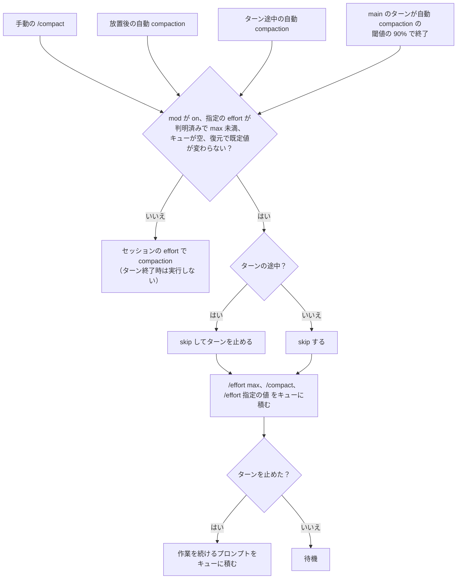

# Claude dynamic effort

[English](README.md)

compaction だけを `max` effort で実行し、それ以外のリクエストは指定した effort のままにする Claude Code の
mod です。以前はコンテキスト量とツールの失敗に応じて effort を上げていましたが、その段階的な引き上げは
[この設計の理由](#この設計の理由)にある根拠から廃止しました。

- 通常のリクエストは、`/effort` や `effortLevel` で指定した effort で実行します。mod は変更しません。
- 手動の `/compact`、放置後の自動 compaction、ターン途中の自動 compaction は、いずれも `max` で実行します。
  指定の effort → compaction の間だけ `max` → 指定の effort に戻る、という動きです。
- ターン途中の自動 compaction では、ターンを止めて compaction し、プロンプトで作業を再開します。
- compaction の発動点は、モデルの 1M window ではなく `autoCompactWindow`（このリポジトリの
  `.claude/settings.json` で 400,000）で決まります。
- `/dynamic-effort on|off|status` で現在のセッションの mod を切り替えます。新しいセッションは on で始まり、
  再開したセッションは切り替えの状態を引き継ぎます。

## 仕組み

Claude Code の compaction のリクエストは `turn.step` を通らず、セッションの effort で実行されます。この
リクエストだけの effort を hook で指定することはできません。セッションの effort を変える唯一の手段である
`/effort` は、セッションが空くまで実行されません。そこで mod は 3 つのコマンドをまとめてキューに積み、
実行されかけた compaction を skip して、キューの `/compact` に置き換えます。



| compaction | mod の動作 | effort |
|---|---|---|
| 手動の `/compact` | `Not compacted · dynamic-effort: compacting again at max effort` と返し、同じ指示で再実行 | `max` |
| ターン途中の自動 compaction | ターンを止めて再実行し、続きのプロンプトを送信 | `max` |
| 放置後の自動 compaction | 再実行 | `max` |
| main のターンが閾値の 90% で終了 | 閾値の手前で compaction し、次のターンを止めずに済ませる | `max` |
| `precompute` | 引き上げが可能な間は skip し、`max` 未満で作った要約を再利用しない | 実行しない |
| subagent 自身の compaction | 変更しない | subagent の値 |

main の compaction には、`/compact` の指示の後に 1 つ指示を加えます。試して捨てた方法を、エラーや理由とともに
残すという指示です。失敗した内容が失われると繰り返しを招き[^mast]、残すべき内容を明示した圧縮の指針は
精度を高めます[^acon]。

## この設計の理由

根拠は [docs/research/report.md](docs/research/report.md) にあります。これは叙述的統合で、統計的なメタ分析では
ありません。以下の測定は Claude Code 2.1.304、Opus 5.5 の値です。回数を示したものは 1 種類の課題で各条件 5 回なので、
方向を示すものであり、回答の品質は測っていません。

- **effort の段階的な引き上げの廃止。** tool loop の途中で effort を変えても、上げても下げても、その step の出力は
  変わりませんでした。tool result 後の出力 token の中央値は `low`→`low` が 4,506、`low`→`max` が 3,200、
  `max`→`max` が 20,962 です。新しいユーザーターンでは効きました（`low`→`low` が 3,395、`low`→`max` が 19,389）。
  [effort のドキュメント](https://platform.claude.com/docs/en/build-with-claude/effort)の、tool result だけのターンは
  新しい入力に数えないという記述と一致します。コンテキスト量に応じて effort を上げる方式を評価した研究は
  見つからず、[Opus 5.5 のガイド](https://platform.claude.com/docs/en/build-with-claude/prompt-engineering/prompting-claude-opus-5-5)は
  `xhigh` と `max` を品質向上を測定できた作業に限るとしています。
- **`autoCompactWindow` は 400,000。** 以前の約 870k という発動点は 1M window から出た値で、effort とは無関係でした。
  Opus 5.5 の `medium` が扱える token 数を測ったデータはなく、事実から絞れるのは下側だけです。100,000 では
  セッション開始後の余裕がほとんどありません。最初に試した 200,000 は compaction が多すぎました。compaction
  直後のコンテキストが 86k〜107k あり、閾値の 167k まで 60k〜81k しか空かず、1 つのセッションで 82 分に 7 回
  発生しました。400,000 の閾値 367k は、唯一の比較研究の範囲（380K まで）に収まります。
- **compaction は `max`。** これも利用者の選択です。要約の effort だけを変えて、その後の成否を測った研究は
  見つからず、効果は未証明です。費用は測定しました。コンテキスト約 66k〜69k で、要約の出力は `medium` が
  945〜1,133 token、`max` が 2,658 token でした。

## compaction の詳細

対話モードで window を 200,000 にしたときの測定値です。

| 項目 | 値 |
|---|---|
| セッション開始時のコンテキスト | 39.7k |
| compaction 前の最後のリクエスト | 173.6k（エンジンは直前のレスポンスを閾値の約 167k と比較） |
| `max` の要約 | 出力 6,287 token、約 1 分、接頭部は cache から読み取り |
| compaction 後のコンテキスト | 65.6k |
| 作業 | ファイルを 1〜7 → compaction → 8〜9 の順に読み、読み飛ばしなし |

- **閾値。** 2.1.304 のバイナリでは `window − min(maxOutput, 20K) − 13K` です。1M なら 967k、400,000 なら 367k、
  200,000 なら 167k で、ターン終了時の発動点はその 90% です。1 バージョンのバイナリから読んだ値で、ドキュメントの
  記載ではありません。
- **確認ダイアログ。** 直接接続のセッションでは、ターン終了後の `/effort` が「Change effort level?」を出すことが
  あります。回答するまでキューは止まり、`No, go back` を選ぶと level は変わらないので、キューの `/compact` は
  その level で実行されます。プロキシ経由と `CLAUDE_CODE_TETHER_LIVE=0` では出ませんでした（各 1 回）。
- **ターンの停止。** `$.turn.abort` は中断マーカーを残しません。バックグラウンドの Bash コマンドと subagent は、
  ターンを止めた後も最後まで完了しました。
- **キューの順序。** エンジンのキューは完全な先入れ先出しではありません。入力したプロンプトやバックグラウンドの
  完了通知は、`/compact` と復元の間に、セッションが `max` のまま実行されることがあります。この間に `max` を継承した
  step は指定の effort で送り、復元はキューが空いた後に実行されます（測定済み）。ヒント行は指定の effort を
  表示したままです。
- **保存される既定値。** `/effort <level>` はその値を既定値としても保存します（`max` だけはセッション限定）。
  このためシーケンスは、ユーザー設定の `effortLevel`（セッションのモデルに `modelSettings` があればそれも）が指定の
  effort と一致するときだけ実行し、復元で保存値が変わらないようにしています。`--effort` など別の経路で指定した値の
  場合は、その effort で compaction します。
- **指定の effort の判定。** 最初の main step のセッション effort、それ以降の `max` 未満の main step、または自分で
  実行した `/effort` です。`max` の step が指定の effort になるのは、自分で `/effort max` を実行したときだけです。
  復元が失われて `max` のまま残ったセッションは、次の main のターン終了時に元に戻します。
- **`/effort max`。** すべてのリクエストと compaction が `max` で実行され、シーケンスは使いません。
- **画面の表示。** compaction のたびに `/effort max`、`/compact`、`/effort <level>` が transcript に表示されます。
  手動の `/compact` では `Not compacted`、ターンを止めたときは続きのプロンプトも表示されます。

## コマンド、設定、表示

| コマンド | 動作 |
|---|---|
| `/dynamic-effort` または `/dynamic-effort status` | 下の状態行を表示します。 |
| `/dynamic-effort on` | compaction を `max` で実行する動作に戻します。 |
| `/dynamic-effort off` | mod がないときと同じく、セッションの effort で compaction します。 |

```text
dynamic=on original=… session=… pending=… last=…
```

`autoCompactWindow` は、このリポジトリの `.claude/settings.json`（`~/.claude/settings.json` にリンク）にあります。
同じファイルでリポジトリの `.claude-plugin/marketplace.json` から `dynamic-effort@dotfiles` を有効にしているので、
すべての Claude Code セッションが mod を読み込みます。

プロンプト下のヒント行からは `(shift+tab to cycle)` を除き、末尾に最後に送った effort を `🧠 <level>` で表示します。
off の間は `🧠 static` です。mod が専用の行を使うことはありません。

## 再開と /clear

- `session.start` で状態をリセットします。同じプロセス内の `/clear`、`/resume`、fork でもリセットし、指定の effort は
  引き継ぎます。
- on/off はセッション ID ごとに mod のストアに保存します（`off:<session id>`、新しい 32 件）。新しいセッションは on で
  始まり、再開したセッションは状態を引き継ぎます。開始時の hook はこの読み込みを待ちます。ストアを読めないときは
  開始時の hook が失敗して Claude Code が報告し、セッションは on のままです。
- エラーは握りつぶしません。hook が待つ処理（ストアや設定の読み込み、ターンの停止、ターン終了時のコンテキストの
  読み取り）は reject し、Claude Code が hook の失敗を報告して、hook がないものとして動作します。設定ファイルを
  読めないときやターンを止められないときは、セッションの effort で compaction します。hook が待たない処理（切り替えの
  保存、キューのコマンド、続きのプロンプト）は `dynamic-effort: <what> failed: <error>` を記録します。エンジンが再実行を
  拒否したときは、もう一度 `/compact` するよう通知し、次の compaction はセッションの effort で実行します。

## 制限

- プロセスの最初の main step より前の compaction は、指定の effort がまだ不明なので、セッションの effort で実行します。
- シーケンスの間に `turn.step` を通らない補助リクエストは `max` を継承します。
- 自身で `max` を指定した subagent も、シーケンスの間の step は下がります。step からは継承した `max` と区別できません。
- compaction 直後のコンテキストが閾値に近いと compaction が繰り返され、`max` で 1 回あたり約 1 分かかります。発生したのは、
  セッションの基本コンテキストが約 120k に増えた検証だけです。ローカルのセッションでは compaction 後は最大 89k でした
  （ただし 200k 以上からの compaction のみの値）。基本コンテキストが大きい場合は window を上げてください。
- `max` での compaction には、指定の effort が既定値として保存されている必要があります（[compaction の詳細](#compaction-の詳細)を参照）。
- 未検証: 回答の品質への影響、ターンを止めたときの `/goal`、シーケンス中の Esc、下げた window の他モデルと subagent への影響。
- 90% という比率は調整していません。
- Claude Code には、モデルごとの effort レベルの一覧を取得する API がありません。モデルが対応していないレベルは、
  Claude Code 側が黙って下げます。
- 開発中にホットリロードすると、mod の状態はリセットされます。

## 開発

```sh
cd tools/claude-dynamic-effort
bun install
bun run check   # oxlint、tsc、vitest のカバレッジ（90% 以上）、claude plugin validate
claude -p --plugin-dir . "/dynamic-effort status"
```

`hooks/register.test.ts` は、偽のエンジンで hook モジュールを vitest から動かすので、カバレッジを強制できます。
性能も検証します。ステップごとに Claude Code へ問い合わせないこと、変更のないイベントをコピーせずに渡すこと、
リクエストの前にマイクロタスクを待たないこと、セッションが伸びてもステップあたりのコストが一定なこと、ヒープが
増えないことです。

`tsc -p tools/claude-dynamic-effort` には、`.claude-plugin/types/claude-code/index.d.ts`（git 管理外）にある Claude Code の
`claude-code` 型が必要です。この mod を読み込む対話セッションが配置します。新しく clone した場合は、
`plugin-authoring` スキルが書き出す `types/claude-code.d.ts` をコピーしてください。リポジトリ直下の `tsconfig.json` は
このフォルダを除外しています。

## 参考文献

[^mast]: Cemri, M., et al. (2025). *Why Do Multi-Agent LLM Systems Fail?* arXiv:2503.13657. <https://arxiv.org/abs/2503.13657>
[^acon]: Kang, M., et al. (2025). *ACON: Optimizing Context Compression for Long-horizon LLM Agents*. arXiv:2510.00615. <https://arxiv.org/abs/2510.00615>
