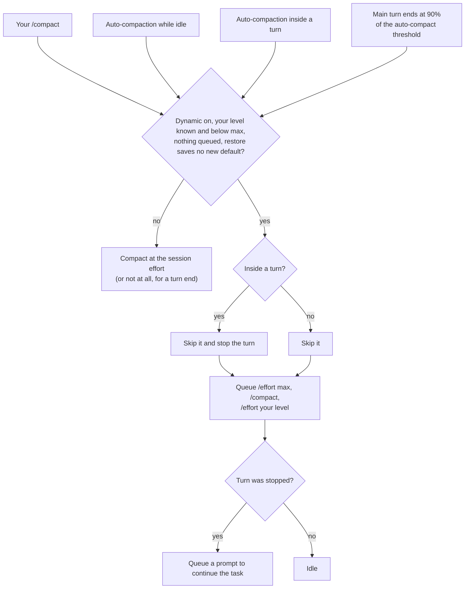

# Claude dynamic effort

[日本語](README-ja.md)

A Claude Code mod that runs every compaction at `max` effort while every other request stays at the
effort you chose. It used to raise effort with context size and tool failures; that ladder is gone,
for the reasons in [Why this design](#why-this-design).

- Normal requests run at your effort, set with `/effort` or `effortLevel`. The mod does not change it.
- Your `/compact`, an idle auto-compaction and an auto-compaction inside a turn all run at `max`: your
  effort, then `max` for one compaction, then your effort again.
- An auto-compaction inside a turn stops the turn, compacts, and resumes the work with a prompt.
- Compaction happens at the size set by `autoCompactWindow` (400,000 in this repository's
  `.claude/settings.json`), not at the model's 1M window.
- `/dynamic-effort on|off|status` controls the mod for the current session. A new session starts on;
  a resumed session keeps the switch it had.

## How it works

Claude Code's compaction request does not pass through `turn.step`; it runs at the session effort. No
hook can set the effort of that request alone, and `/effort`, the only way to change the session
effort, waits until the session is idle. So the mod queues three commands together, skips the
compaction that was about to run, and lets the queued `/compact` replace it.



| Compaction | What the mod does | Effort |
|---|---|---|
| Your `/compact` | Answers `Not compacted · dynamic-effort: compacting again at max effort` and reruns it with the same focus | `max` |
| Auto-compaction inside a turn | Stops the turn, reruns it, then submits a prompt to continue | `max` |
| Auto-compaction while idle | Reruns it | `max` |
| Main turn ends at 90% of the threshold | Compacts ahead of the threshold, which saves stopping the next turn | `max` |
| `precompute` | Skipped while a raise is possible, so no summary made below `max` is reused | not run |
| A subagent's own compaction | Left alone | the subagent's |

Main compactions also get one instruction after your own `/compact` focus: list approaches that were
tried and abandoned, with the error or reason. Losing what failed invites repeating it[^mast], and a
compression guideline that names what must survive improves accuracy[^acon].

## Why this design

The research behind this is in [docs/research/report.md](docs/research/report.md). It is a narrative
synthesis, not a statistical meta-analysis. The measurements below are from Claude Code 2.1.304 on
Opus 5.5, with one task and five runs per condition where runs are given, so they show direction and
do not measure answer quality.

- **No effort ladder.** A mid-loop effort change did not change that step's output in either
  direction. Median output tokens after a tool result were 4,506 for `low`→`low`, 3,200 for `low`→`max`
  and 20,962 for `max`→`max`. At a new user turn the change did work: 3,395 for `low`→`low` and 19,389
  for `low`→`max`. This matches the [effort docs](https://platform.claude.com/docs/en/build-with-claude/effort),
  which say a turn holding only tool results does not count as new input. No study found evaluates
  raising effort with context size, and the
  [Opus 5.5 guide](https://platform.claude.com/docs/en/build-with-claude/prompt-engineering/prompting-claude-opus-5-5)
  reserves `xhigh` and `max` for work with a measured quality gain.
- **`autoCompactWindow` is 400,000.** The earlier 870k compaction point came from the 1M window, not
  from anything about effort. Nobody has measured how many tokens `medium` handles on Opus 5.5, so the
  facts narrow only the lower side: 100,000 leaves almost no room after session start. 200,000 was tried
  first and compacted too often. Context right after a compaction was 86k to 107k, which left only 60k
  to 81k before the 167k threshold, and one session compacted 7 times in 82 minutes. The 367k threshold
  of 400,000 stays inside the range the one comparison study covers (up to 380K).
- **Compaction at `max`** is also the person's choice. No study was found that varies only the
  summarizer's effort and measures what follows, so the benefit is unproven. The cost was measured: at
  about 66k to 69k of context, summaries took 945 to 1,133 output tokens at `medium` and 2,658 at `max`.

## Compaction details

Measured in an interactive session with the window at 200,000:

| Point | Value |
|---|---|
| Context at session start | 39.7k |
| Last request before the compaction | 173.6k (the engine compares the last response with its threshold, about 167k) |
| Summary at `max` | 6,287 output tokens, about one minute, prefix read from the cache |
| Context after it | 65.6k |
| Work | Files read in order 1–7, compaction, 8–9, with none skipped |

- **Threshold.** The 2.1.304 binary computes it as `window − min(maxOutput, 20K) − 13K`, so 1M gives 967k
  400,000 gives 367k and 200,000 gives 167k. The turn-end point is 90% of that. This comes from one binary
  version, not from the docs.
- **Confirmation dialog.** In a direct session `/effort` can open "Change effort level?" after a finished
  turn. The queue waits for the answer, and `No, go back` keeps the level, so the queued `/compact` runs
  at that level. The dialog did not appear through a proxy or with `CLAUDE_CODE_TETHER_LIVE=0`, one run
  each.
- **Stopping a turn.** `$.turn.abort` leaves no interruption marker. A background Bash command and a
  background subagent both finished after their turn was stopped.
- **Queue order.** The engine's queue is not strictly first in, first out. A prompt you type or a
  background notification can run between `/compact` and the restore, while the session is still at
  `max`. Any step that inherits `max` during the sequence is sent at your level, and the restore runs
  once the queue is clear (measured). The hint line keeps showing your level.
- **Saved default.** `/effort <level>` also saves the level as the default (only `max` is session-only).
  The sequence runs only when the user settings already hold your level as `effortLevel`, and as the
  session model's `modelSettings` entry when there is one, so the restore changes no saved value. A level
  from `--effort` or another source compacts at that level instead.
- **Your level.** It is the session effort of the first main step, any later main step below `max`, or
  your own `/effort`. A step at `max` becomes your level only through your own `/effort max`. A session left
  at `max` by a dropped restore is set back at the next main turn end.
- **`/effort max`.** Every request and compaction runs at `max`, with no sequence.
- **What you see.** Each compaction shows its commands in the transcript: `/effort max`, `/compact` and
  `/effort <level>`, plus `Not compacted` for your own `/compact` and the continue prompt for a stopped turn.

## Commands, settings and display

| Command | Effect |
|---|---|
| `/dynamic-effort` or `/dynamic-effort status` | Prints the status line below. |
| `/dynamic-effort on` | Resumes compaction at `max`. |
| `/dynamic-effort off` | Compacts at the session effort, like Claude Code without the mod. |

```text
dynamic=on original=… session=… pending=… last=…
```

`autoCompactWindow` sits in this repository's `.claude/settings.json`, linked to
`~/.claude/settings.json`. That file also enables `dynamic-effort@dotfiles` from the repository's `.claude-plugin/marketplace.json`,
so every Claude Code session loads the mod.

The hint line under the prompt drops `(shift+tab to cycle)` and ends with `🧠 <level>`, the level last
sent, or `🧠 static` while off, so the mod takes no row of its own.

## Resume and /clear

- `session.start` resets the state. An in-process `/clear`, `/resume` or fork resets it too, keeping your
  level.
- The on/off switch is kept per session id in the mod's store (`off:<session id>`, the newest 32). A new
  session starts on; a resumed session keeps its switch. The start hooks wait for this read. A store that
  cannot be read fails the start hook, which Claude Code reports, and the session stays on.
- Errors are never swallowed. Work a hook awaits (reading the store or the settings, stopping a turn, the
  context read at a turn end) rejects, so Claude Code reports the hook and runs as if it were not there:
  an unreadable settings file or a turn that cannot be stopped leaves the compaction at the session effort.
  Work no hook awaits (saving the switch, a queued command, the continue prompt) logs
  `dynamic-effort: <what> failed: <error>`. If the engine refuses the rerun, a toast asks for `/compact`
  again and the next compaction runs at the session effort.

## Limits

- A compaction before the first main step of a process runs at the session effort, because your level is
  not known yet.
- A side request that skips `turn.step` during the sequence inherits `max`.
- A subagent that asks for `max` itself is lowered if it steps during the sequence, since a step cannot
  tell that from an inherited `max`.
- When the context right after a compaction sits close to the threshold, compactions repeat, each taking
  about a minute at `max`. It happened only in a test that raised the session's base context to about 120k.
  Local sessions measured 89k at most after compacting, though only from 200k or more. Raise the window if
  your base context is large.
- Compacting at `max` needs your level saved as the default (see [Saved default](#compaction-details)).
- Not tested: the effect on answer quality, `/goal` during a stopped turn, pressing Esc during the
  sequence, and how a lowered window reaches other models and subagents.
- The 90% ratio is not tuned.
- Claude Code exposes no per-model list of effort levels; the engine silently downgrades a level the
  model lacks.
- Module state restarts on a hot reload (development only).

## Development

```sh
cd tools/claude-dynamic-effort
bun install
bun run check   # oxlint, tsc, vitest coverage (>= 90%), claude plugin validate
claude -p --plugin-dir . "/dynamic-effort status"
```

`hooks/register.test.ts` drives the hooks module under vitest with a fake engine, so coverage can be
enforced. It also guards performance: no host call per step, unchanged events passed on without a copy,
no microtask before a request, constant per-step cost as a session grows, and a flat heap.

`tsc -p tools/claude-dynamic-effort` needs the engine's `claude-code` types in
`.claude-plugin/types/claude-code/index.d.ts` (git-ignored). An interactive session that loads the mod
lays them there; on a fresh clone, copy the `types/claude-code.d.ts` that the `plugin-authoring` skill
writes. The repository root `tsconfig.json` excludes this folder.

## References

[^mast]: Cemri, M., et al. (2025). *Why Do Multi-Agent LLM Systems Fail?* arXiv:2503.13657. <https://arxiv.org/abs/2503.13657>
[^acon]: Kang, M., et al. (2025). *ACON: Optimizing Context Compression for Long-horizon LLM Agents*. arXiv:2510.00615. <https://arxiv.org/abs/2510.00615>
