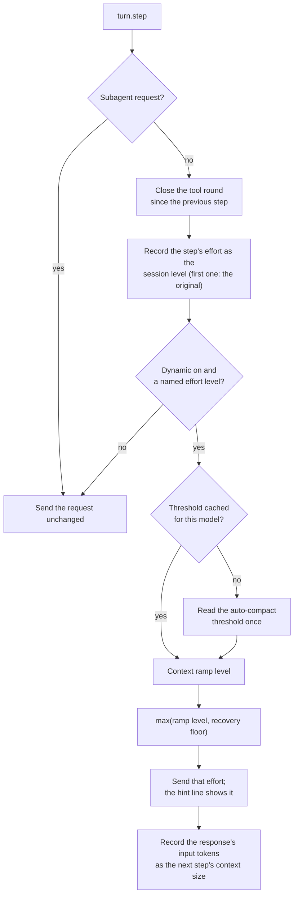
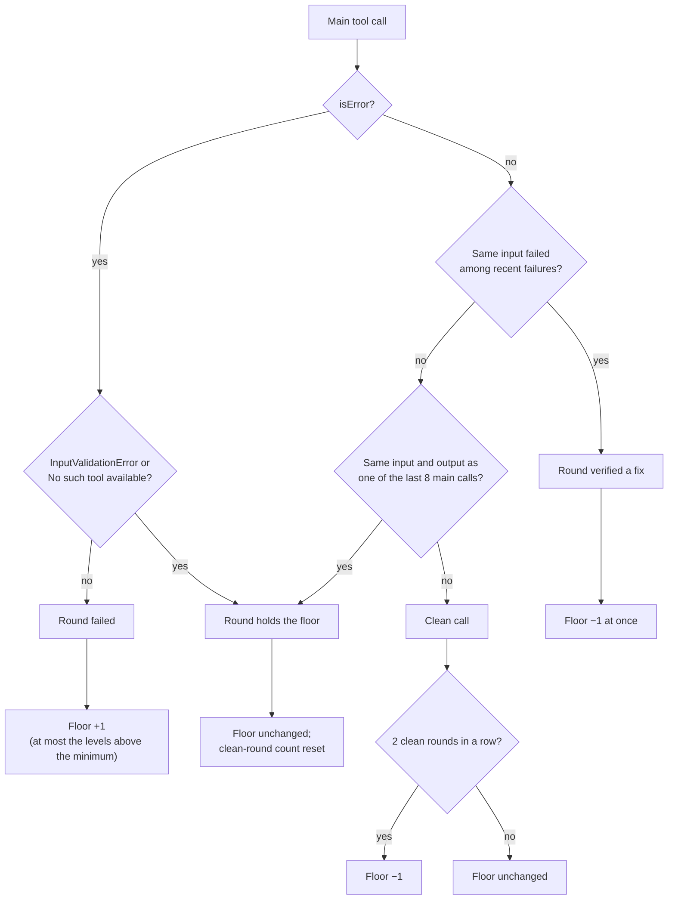
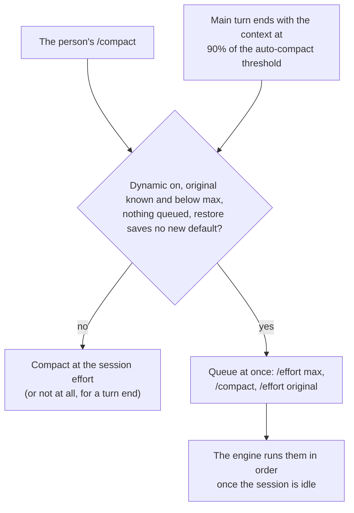

# Claude dynamic effort

[日本語](README-ja.md)

A Claude Code mod that chooses the reasoning effort of every main-thread model request from
evidence gathered during the session. It began as a port of the dynamic work-effort part of
`tools/pi-effort-manager` and was redesigned from the research cited below.

- Each main request is sent at the higher of two levels: a context ramp and a recovery floor raised
  by failed tool calls. Levels run from a selectable minimum (default `low`) up to `xhigh`.
- Repeats and malformed calls hold the floor, a verified fix lowers it at once, and two clean rounds
  lower it one level. After three failing rounds in a row at the cap, the failing result carries one
  note asking the model to change approach.
- Claude Code's own compaction runs at `max`, with one extra instruction to keep abandoned
  approaches. The session effort is raised only for that one compaction, so subagents and side
  requests keep the original.
- `/dynamic-effort on|off|status` controls the mod for the current session. A new session starts
  on; a resumed session keeps the switch it had.

## Why dynamic effort

A fixed effort has to be one of two compromises: high enough for the hardest step, which wastes
reasoning (and time) on routine steps, or low enough for routine steps, which fails the hard ones.
Choosing effort per step avoids both. The benefits below are results of the cited studies; this
package has not been measured on a task benchmark.

- **Accuracy where it matters.** Error-correcting and re-planning steps needed high effort, and
  running every step at low effort lost accuracy[^ares].
- **Less reasoning for the same result.** Per-step effort selection matched or beat fixed high effort
  with up to 52.7% fewer reasoning tokens[^ares]. Allocating test-time compute by difficulty was over
  4x more efficient than a best-of-N baseline[^snell], and learning when to think cut response length
  by 53% while raising accuracy by 2.4%[^adaptthink].
- **Less overthinking.** More reasoning correlated with fewer resolved agentic tasks[^overthinking],
  reasoning models spend excessive compute on simple problems[^chen], and longer reasoning can lower
  accuracy[^inverse].
- **Robustness on long sessions.** Accuracy degrades as context grows[^contextrot], so effort rises
  with context instead of being spent evenly from the first step.
- **Faster routine steps.** Routine steps run at the minimum level instead of a fixed high level, so
  they wait less between tool calls.

## How effort is chosen

The `turn.step` hook rewrites `effort` before each main request. Subagent requests, models without
effort, and numeric (budget) efforts pass through unchanged.



**Context ramp.** Context size is the input side of the previous main response
(`input + cache_read + cache_creation` tokens), the figure the status line shows. Up to 60% of the
auto-compact threshold the level is the minimum; the rest of the range is split evenly into the
levels above it, up to `xhigh`. With the default `low`, about 60–73% is `medium`, 73–87% `high` and
above that `xhigh`. The threshold is read once per model from Claude Code's local estimate.

**Minimum.** The plugin's `minEffort` option (a picker in the config menu: `low`, `medium`, `high`,
`xhigh`) sets the lowest level; an unknown value falls back to `low`. The default is `low`, so
routine steps start as cheap as they can and the context ramp and failures raise them. Choose
`medium` if that costs accuracy: too small a token budget can cost more tokens, not fewer (token
elasticity)[^tale], and all-low steps lose accuracy[^ares].

**Manual choice.** The person's own `/effort <level>` sets the minimum for the session: the ramp and
the recovery floor rise from that level, `/effort max` sends `max` on every main step, and
`/effort auto` returns to the configured minimum, so the level follows the context ramp and the
recovery floor again. A new session, a resumed one (`claude --resume` or an in-process `/resume`),
`/clear` and a fork also start from the configured minimum and ramp from their own context.

**Effort sent.** The higher of the ramp level and the recovery floor, never above `xhigh` unless the
person chose `max`.

## Recovery evidence

Main-thread tool calls are scored per tool round (the calls between two main requests) while
dynamic mode is on:



- **Failure raises.** A failed call (`isError`) raises the floor one level for its round.
- **A repeat holds.** A call that repeats one of the last 8 main calls with the same input and output
  made no progress, but polling a long job repeats too, so it blocks the decay without raising.
- **A malformed call holds.** Claude Code's `InputValidationError` and `No such tool available`
  errors need a corrected call, not deeper reasoning: stronger reasoning raises tool
  hallucination[^reasoningtrap].
- **A verified fix lowers at once.** A call whose input failed earlier and now succeeds (a test or
  build that now passes) lowers the floor one level immediately[^deer][^selfdebug]. No output text is
  interpreted.
- **Clean rounds lower.** Two clean rounds in a row lower the floor one level.
- **Signatures.** Top-level input keys are sorted, volatile keys (`tool_use_id`, `requestMeta`,
  `description`) are dropped, and input and output are compared by length plus head and tail
  slices (512 and 256 characters).

**Stuck note.** When the floor is at the cap (`xhigh`) and a round fails for the third time in a
row there, the first failing tool result of that round gets one appended context note: the approach has failed for several rounds
at the highest work effort; state what is blocking, then try a different approach or ask the
person. More reasoning on the same path stops paying[^mirage] and failed runs are the expensive
ones[^swe-effi]. The note is external evidence, not intrinsic self-correction[^huang]. It is
appended after the result, so the prompt cache is untouched. A non-failing round resets the count,
so the note can come again only after another run of failures.

## Compaction and subagents

Claude Code's compaction request does not pass through `turn.step`; it runs at the session effort.
Measured on one conversation, the summary used 934 output tokens at `low` and 1,898 at `max`. No
hook can set the effort of that request alone, and `/effort` is the only way to change the session
effort, queued until the session is idle. The session effort also reaches subagents and side
requests that skip `turn.step`, so it stays at the original and is raised only for the length of one
compaction.



- The three commands are queued together, so the restore is already in the engine's queue before
  the level rises, and a skipped or failed compaction still ends at the original (verified: the
  engine runs them in order). That the queue survives the mod stopping or reloading meanwhile is
  the design's intent, not something tested; a reload also forgets the original, so nothing would
  repair a dropped restore until the person runs `/effort`. Whether a prompt queued by the person
  can run between the commands is untested.
- `/effort <level>` also saves the level as the default for new sessions (only `max` is session-only).
  The sequence runs only when the user settings already hold the original as `effortLevel` (and as
  the session model's `modelSettings` entry, when there is one), so the restore changes no saved
  value. A level from `--effort` or another source compacts at that level instead. The rewrite can
  reorder keys in `~/.claude/settings.json`.
- The person's `/compact` is answered with `Not compacted · dynamic-effort: compacting again at max
  effort` and run again inside the sequence, with the same focus. If the engine refuses the re-run,
  a toast asks for `/compact` again, and that one runs at the session effort.
- Auto-compaction inside a turn cannot be reached by `/effort`, so a main turn end compacts ahead of
  it once the context reaches 90% of the auto-compact threshold. Compaction therefore happens a little
  earlier than the engine alone would, and only when auto-compaction is on. An auto-compaction that
  still happens inside a turn runs at the original effort.
- The original effort is the session effort seen on the first main request, or the person's own
  later `/effort`. A step at `max` is never taken as the original, since an earlier version of this
  mod left sessions at `max`; only the person's `/effort max` makes it one. Once the original is
  known, a session left at `max` (a dropped restore) is set back at the next main turn end. A session
  that an earlier version left at `max` has no known original, so start it anew.
- A `precompute` compaction is skipped while a raise to `max` is possible and the session is not there
  yet, so no summary made at the original effort is reused.
- Each compaction at `max` shows its commands in the transcript: the person's `/compact` as
  `Not compacted`, then `/effort max`, `/compact` and the restore `/effort <original>`.
- Main compactions get one instruction after the person's own `/compact` focus: also list approaches
  that were tried and abandoned, with the error or reason. Losing what failed invites repeating
  it[^mast], and a compression guideline that names what must survive keeps accuracy at fewer
  tokens[^acon].
- After a main compaction, the context size is reset to the compacted size (`tokensAfter`) and the
  repeat window is cleared; the recovery floor survives.

## Resume and /clear

- `session.start` resets the state. An in-process `/clear`, `/resume` or fork
  (`classic.SessionStart` with source `clear`, `resume` or `fork`) resets it too, keeping the
  person's original effort, so the new conversation does not inherit the old context size or
  failure evidence.
- The on/off switch is kept per session id in the mod's store, one key per session switched off
  (`off:<session id>`, the newest 32), so sessions switching at once never overwrite each other. A new session has a new id and starts on; a resumed session keeps its id, so a
  session switched off stays off. The start hooks wait for this read, so no step is sent before it
  applies. A store that cannot be read fails the start hook, which Claude Code reports, and the session
  stays on.
- Errors are never swallowed. Work a hook awaits (reading the store or the settings, the context
  estimate at a turn end) rejects, so Claude Code reports the hook and runs as if it were not there:
  an unreadable settings file leaves the compaction at the session effort. Work no hook awaits (the
  background prefetch, saving the switch, a queued command) logs `dynamic-effort: <what> failed:
  <error>` to the transcript.
- In the background, a prefetch takes Claude Code's local estimate of the context size and threshold
  (no request), and a session that already has prompts replays its last 8 tool rounds from the
  transcript to rebuild the floor and the repeat window. A generation guard drops work from an
  earlier reset, and a step that already ran is not overwritten.
- Resuming never triggers compaction: the mod only reads. Measured: resuming a session whose last
  tool round failed sent the first request at `high`, with no compaction request.

## Design and evidence

| Mechanism | Evidence | Risk it avoids |
|---|---|---|
| Decide per step, not per task | Per-step effort selection matched fixed high effort with fewer tokens[^ares]; compute by difficulty beats a fixed budget[^snell]. | Wasting reasoning on routine steps. |
| `low` default minimum, raised by evidence | Too small a budget can cost more tokens[^tale]; all-low steps lose accuracy[^ares]; failures and context raise the level. | Spending reasoning on routine steps. |
| Raise on failures | Error-correcting steps need the most effort[^ares]; failure feedback improves agents[^reflexion]. | Retrying a hard step with too little reasoning. |
| Raise with context | Accuracy degrades as input grows[^contextrot]. | Errors late in long sessions. |
| `xhigh` cap, quick decay | More reasoning correlates with fewer resolved tasks[^overthinking]; longer reasoning can lower accuracy[^inverse][^chen]. | Overthinking and cost. |
| Repeat holds the floor | Step repetition is a common agent failure mode[^mast]. | Decaying while stuck; raising while polling. |
| Malformed call holds the floor | Stronger reasoning raises tool hallucination[^reasoningtrap]. | Raising effort for a schema error. |
| Verified fix lowers at once | Shorter reasoning once the answer is confirmed is cheaper and more accurate[^deer]; execution feedback guides repair[^selfdebug]. | Holding a raised level after recovery. |
| Only external evidence raises effort | Self-correction without external feedback can make answers worse[^huang]. | Reacting to the model's own text. |
| Stuck note at the cap | More thinking can stop helping[^mirage]; failed runs cost the most[^swe-effi]. | Spending the cap on a dead end. |
| Compaction keeps abandoned approaches | Naming what a compression must keep preserves accuracy[^acon]; repetition[^mast]. | Repeating what already failed. |

Changing effort kept the prompt cache in Claude Code measurements on the Claude API (Sonnet 5.5,
Opus 5.5), although the API documentation lists effort among cache-invalidating changes[^caching];
Bedrock and Foundry are unverified.

## Commands, settings and display

| Command | Effect |
|---|---|
| `/dynamic-effort` or `/dynamic-effort status` | Prints the status line below. |
| `/dynamic-effort on` | Resumes dynamic effort and compaction at `max`. |
| `/dynamic-effort off` | Sends the session effort unchanged, stops collecting recovery evidence, and compacts at the session effort. |

Status output:

```text
dynamic=on original=… session=… pending=… last=… min=… end=xhigh levels=… compactLimits=… context=… recoverySteps=…
```

The `minEffort` setting is in the plugin's config menu (`low`, `medium`, `high`, `xhigh`; default
`low`). The hint line under the prompt (the permission mode's row) drops `(shift+tab to cycle)` and
ends with `🧠 <level>`, the level last sent, or `🧠 static` while off, so the mod takes no row of its
own: `⏵⏵ bypass permissions on · ← for agents · 🧠 low`. The mode label itself is drawn by Claude
Code and is not shortened; the spinner line is left as Claude Code draws it. Claude Code's own effort indicator
shows the session effort, the original outside a compaction.

## Performance

- With the threshold cached, a step is decided synchronously: no host call, promise or microtask
  before the request. The threshold is prefetched at session start without blocking it, then cached
  per model.
- A long string in a tool input (a written file's content) is condensed to its length, head and tail
  before the input is serialized, so a large input is never copied whole: 200 calls with a 1 MB
  input took about 0.6 ms instead of 75 ms.
- The repeat window and failed inputs are fixed rings of 8 bounded signatures; recovery state is one
  mutable object per session. Lookups and per-level texts are built once.
- Unchanged events (unchanged efforts, other command output) are passed on without a copy.
- `next<string>(e)` in the `tool.call` hook passes the type argument explicitly, which skips the
  costliest inference in the file during type checking.

## Limits

- The heuristics (60% ramp start, two clean rounds, a window of 8 calls, three stuck rounds) are not
  tuned on a benchmark. Log per-level reasoning tokens and outcomes before changing them.
- Claude Code exposes no per-model list of effort levels; the engine silently downgrades a level the
  model lacks.
- Module state restarts on a hot reload (development only).
- Compacting at `max` needs the original saved as the default (see Compaction); otherwise compaction
  runs at the original effort. An auto-compaction inside a turn also runs at the original effort.
- The mod compacts at 90% of the auto-compact threshold, a little earlier than the engine would.
- A queued `/effort` runs once the session is idle; a dropped restore is retried at the next main
  turn end.

Not ported from pi: `Ctrl+Shift+E`, `/fast`, the bounded compaction guard, the compaction reset
interval, and session overrides of the start and end levels.

## Development

```sh
cd tools/claude-dynamic-effort
bun install
bun run check   # oxlint, tsc, vitest coverage (>= 90%), claude plugin validate
claude -p --plugin-dir . "/dynamic-effort status"
```

`hooks/register.test.ts` drives the hooks module under vitest with a fake engine, so coverage can be
enforced. It also guards performance:

- no host call per step after the threshold lookup;
- unchanged events passed on without a copy;
- no microtask before a request once the threshold is cached;
- constant per-step cost as a session grows (time ratio between a 4k and a 40k step session);
- a flat heap after GC across 400k tool calls.

`tsc -p tools/claude-dynamic-effort` needs the engine's `claude-code` types in
`.claude-plugin/types/claude-code/index.d.ts` (git-ignored). An interactive session that loads the
mod lays them there; on a fresh clone, copy the `types/claude-code.d.ts` that the `plugin-authoring`
skill writes. The repository root `tsconfig.json` excludes this folder.

This repository's `.claude/settings.json` (linked to `~/.claude/settings.json`) names the folder in
`CLAUDE_CODE_PLUGIN_DIRS` in its `env` block, so every Claude Code session loads the mod. Claude Code
reads that variable only from the user settings or the process environment, never from a project's
settings.

## References

[^ares]: Yang, J., et al. (2026). *Ares: Adaptive Reasoning Effort Selection for Efficient LLM Agents*. arXiv:2603.07915. <https://arxiv.org/abs/2603.07915>
[^snell]: Snell, C., Lee, J., Xu, K., & Kumar, A. (2024). *Scaling LLM Test-Time Compute Optimally can be More Effective than Scaling Model Parameters*. arXiv:2408.03314. <https://arxiv.org/abs/2408.03314>
[^adaptthink]: Zhang, J., Lin, N., Hou, L., Feng, L., & Li, J. (2025). *AdaptThink: Reasoning Models Can Learn When to Think*. arXiv:2505.13417. <https://arxiv.org/abs/2505.13417>
[^overthinking]: Cuadron, A., et al. (2025). *The Danger of Overthinking: Examining the Reasoning-Action Dilemma in Agentic Tasks*. arXiv:2502.08235. <https://arxiv.org/abs/2502.08235>
[^chen]: Chen, X., et al. (2024). *Do NOT Think That Much for 2+3=? On the Overthinking of o1-Like LLMs*. arXiv:2412.21187. <https://arxiv.org/abs/2412.21187>
[^inverse]: Gema, A. P., et al. (2025). *Inverse Scaling in Test-Time Compute*. arXiv:2507.14417. <https://arxiv.org/abs/2507.14417>
[^contextrot]: Hong, K., Troynikov, A., & Huber, J. (2025). *Context Rot: How Increasing Input Tokens Impacts LLM Performance*. Chroma technical report. <https://research.trychroma.com/context-rot>
[^tale]: Han, T., et al. (2024). *Token-Budget-Aware LLM Reasoning*. arXiv:2412.18547. <https://arxiv.org/abs/2412.18547>
[^reasoningtrap]: Yin, C., et al. (2025). *The Reasoning Trap: How Enhancing LLM Reasoning Amplifies Tool Hallucination*. arXiv:2510.22977. <https://arxiv.org/abs/2510.22977>
[^deer]: Yang, C., et al. (2025). *Dynamic Early Exit in Reasoning Models*. arXiv:2504.15895. <https://arxiv.org/abs/2504.15895>
[^selfdebug]: Chen, X., Lin, M., Schärli, N., & Zhou, D. (2024). *Teaching Large Language Models to Self-Debug*. ICLR 2024. arXiv:2304.05128. <https://arxiv.org/abs/2304.05128>
[^mirage]: Ghosal, S. S., et al. (2025). *Does Thinking More always Help? Mirage of Test-Time Scaling in Reasoning Models*. arXiv:2506.04210. <https://arxiv.org/abs/2506.04210>
[^swe-effi]: Fan, Z., et al. (2025). *SWE-Effi: Re-Evaluating Software AI Agent System Effectiveness Under Resource Constraints*. arXiv:2509.09853. <https://arxiv.org/abs/2509.09853>
[^huang]: Huang, J., Chen, X., Mishra, S., Zheng, H. S., Yu, A. W., Song, X., & Zhou, D. (2024). *Large Language Models Cannot Self-Correct Reasoning Yet*. ICLR 2024. arXiv:2310.01798. <https://arxiv.org/abs/2310.01798>
[^reflexion]: Shinn, N., Cassano, F., Berman, E., Gopinath, A., Narasimhan, K., & Yao, S. (2023). *Reflexion: Language Agents with Verbal Reinforcement Learning*. NeurIPS 2023. arXiv:2303.11366. <https://arxiv.org/abs/2303.11366>
[^mast]: Cemri, M., et al. (2025). *Why Do Multi-Agent LLM Systems Fail?* arXiv:2503.13657. <https://arxiv.org/abs/2503.13657>
[^acon]: Kang, M., et al. (2025). *ACON: Optimizing Context Compression for Long-horizon LLM Agents*. arXiv:2510.00615. <https://arxiv.org/abs/2510.00615>
[^caching]: Anthropic. *Prompt caching*. Claude API documentation. <https://platform.claude.com/docs/en/build-with-claude/prompt-caching>
