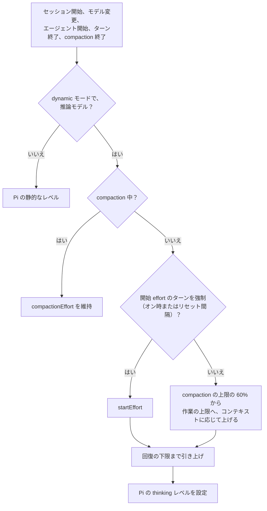
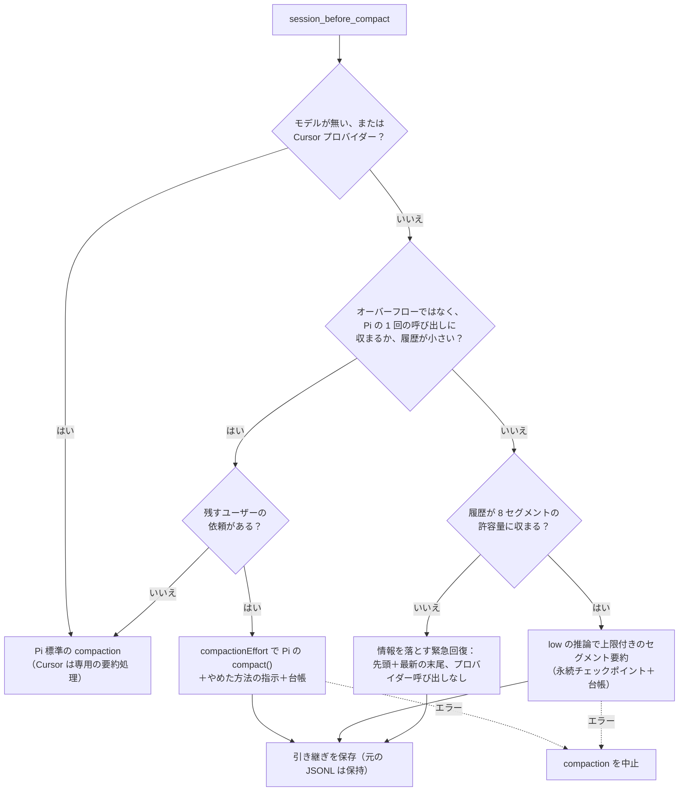
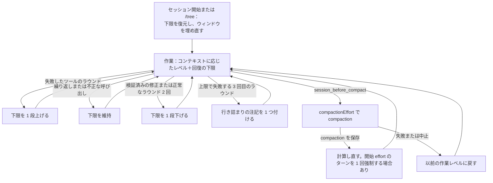

# Pi effort manager

[English](README.md)

リポジトリで管理している、推論 effort を動的に管理する Pi パッケージです。Pi 標準の静的な effort
操作を拡張するもので、以前使っていたサードパーティ製パッケージには実行時に依存しません。
SDK 互換性の基準は Pi 1.0.4 で、ローカルの依存関係と peer の要件は、その正規化されたトランスクリプト
API に合わせています。更新後はこのディレクトリで `bun install` を実行し、Pi を reload または再起動して
ください。

**既定の状態。** dynamic モードは、設定で `dynamicDefault` が `true` でない限りオフです（セッションに
保存された状態と `--dynamic-effort on|off` フラグが優先されます）。進捗テキストは、
`progressTextOnCompaction` または `progressTextOnEffortChange` を明示的に `true` にしない限りオフです。
上限付きの compaction の安全機構は別の拡張で、常に読み込まれます。

## 操作

静的な effort の選択は、引き続き Pi 標準の操作が正となります。

- `Shift+Tab` で effort レベルを切り替えます。
- `--thinking <level>` で初期レベルを選びます。
- `defaultThinkingLevel` で Pi の既定レベルを設定します。

このパッケージはこれらの操作を再定義しません。追加する操作は次のとおりです。

- `/fast [on|off]` は、`openai`、`openai-codex`、`azure-openai-responses` プロバイダーの GPT-5
  モデルで優先サービス枠を切り替えます。グローバル設定に保存されます。
- `/dynamic-effort on|off|status`（引数なしは `status` です）。
- `/dynamic-effort start <level|default>`、または別名の `/dynamic-effort min <level|default>` で、
  作業の最低 effort を設定します。
- `/dynamic-effort end <level|default>` で作業の上限を設定します。
- `/dynamic-effort compact <level|default>`、または別名の `compaction` で、compaction の effort を
  設定します。
- `/dynamic-effort reset-effort <level|default>`
- `/dynamic-effort reset <positive-integer|default>`
- `Ctrl+Shift+E` はこのパッケージが定義する唯一のショートカットで、セッションの dynamic モードを
  切り替えます。`Ctrl+Shift+D` は、Pi の TUI が `pi-debug.log` の書き出し用に予約しています。
- `--dynamic-effort on|off` は、復元した状態や既定のモードより優先されます。

`start|min|end|compact|compaction|reset-effort|reset` はセッション内だけの上書きを作り、`default` で
解除します。`reset-effort` または `reset` を変えると、対象となる compaction の回数もリセットされます。
dynamic モードをオンにすると、開始 effort のターンを 1 回強制します。

## effort の選び方

dynamic モードは、使用中の Pi モデルから対応レベルを調べます（Pi のレベルは `minimal`、`low`、
`medium`、`high`、`xhigh`、`max` です）。プロバイダー側で同じレベルに対応づけられるものは 1 つに
まとめます。範囲は 3 つの境界で決まります。

- **最低 effort：** `startEffort`（既定は `medium`）。作業の effort はこれより下がりません。
- **作業の上限：** `endEffort`（既定は対応レベルのうち 2 番目に深いもの）。最も深いレベルは
  compaction 用に残します。
- **compaction の effort：** `compactionEffort`（既定は対応レベルのうち最も深いもの）。

モデルが対応していない境界を設定した場合は、次に深い対応レベルに、それも無ければ既定値に解決します。
開始レベルが上限より上にある場合、作業は開始レベルだけを使います。レベルが 1 つしかないモデルは、
作業にも compaction にもそのレベルを使います。推論のないモデルは変更しません。



compaction の上限は、コンテキストウィンドウから `compaction.reserveTokens`（未設定なら 16,384）を
引いた量です。その上限の `rampStartRatio`（0.6）までは開始レベルを使い、それを超えると、残りの範囲を
上限までの作業レベルに均等に割り当てます。

`session_before_compact` で、コントローラーは現在の作業レベルを保存し、Pi のレベルを compaction の
effort に設定します。compaction が成功すると、現在のコンテキスト使用量から計算し直します。compaction
がリセット間隔に数えられるのは、compaction 前のレベルが `compactionResetEffort`（既定は `xhigh`）以上
の場合だけです。対象となる compaction が `compactionResetInterval`（既定は 1）回ごとに、開始 effort
のターンを 1 回強制します。compaction が失敗すると、保存した作業レベルに戻します。

## 回復の下限

dynamic な作業の effort には、根拠に基づく回復の下限もあり、開始レベルから何段上かで数えます。
完了したツールのラウンドごとに、次のように分類します（`src/recovery-effort.ts`）。

| ラウンド                                                                                                   | 下限への影響      |
| ---------------------------------------------------------------------------------------------------------- | ----------------- |
| 失敗（`isError` で、不正な呼び出しではないもの）が 1 つ以上。同じラウンドの複数の失敗は 1 回と数える       | 1 段上げる        |
| 繰り返し：直近 8 件の呼び出しのどれかと、ツール、引数（自由記述の `description` を除く）、出力がすべて同じ | 維持（下げない）  |
| 不正な呼び出し：Pi の `Validation failed for tool …` または `Tool "x" not found`                           | 維持              |
| 検証済みの修正：以前に失敗した入力の呼び出しが成功し、そのラウンドに失敗がない                             | すぐに 1 段下げる |
| 正常なラウンドが 2 回続く                                                                                  | 1 段下げる        |
| 空のラウンド、数え済みのターン、推論プロファイルがない場合                                                 | 何もしない        |

繰り返しで上げずに維持するのは、tmux の確認のような長いジョブのポーリングも繰り返しになるためです。
不正な呼び出しに必要なのは、より深い推論ではなく呼び出しの修正です。推論を強めるとツールの幻覚が
増えます[^reasoningtrap]。下限は作業レベルの数から 1 を引いた値までなので、レベルで表せる以上には
上がりません。実際のレベルは、この下限とコンテキストに応じたレベルの深い方です。下限は、動いたとき
だけブランチ内のセッションエントリーに保存します。

**行き詰まりの注記。** 作業の上限で失敗するラウンドが 3 回続くと、3 回目のラウンドで最初に失敗した
ツールの結果に、テキストの注記を 1 つ付け加えます。内容は「この方法は最も高い作業 effort で何ラウンド
も失敗しているので、何が妨げになっているかを述べ、別の方法を試すか、人に尋ねること」です。注記は
1 回だけで、失敗しないラウンドの後に再び有効になります。

**シグネチャ。** 呼び出しは、ツール名、引数の JSON（長さと先頭・末尾の 512 文字）、結果（長さと
先頭・末尾の 256 文字）で識別します。そのため、長い入力や出力が中間だけ違う場合は繰り返しと
みなしません。再開時は、両方のウィンドウ（直近の呼び出しと失敗した入力）を、ブランチの最後の 64 件の
メッセージにあるツールの結果から埋め直します。下限そのものは保存したエントリーから復元し、数え直し
ません。再開時は開始 effort を強制せずにコンテキストからレベルを計算し直し、compaction を起こすことも
ありません。

## 設計の根拠

以下の利点はすべて引用した研究によるもので、このパッケージで測定したものではありません。このパッケージ
はタスクのベンチマークで評価していません。しきい値は経験則で、学習済みのルーターではありません
[^ares]。調整の前に、レベルごとの推論量と結果を記録してください。

| 仕組み                                                            | 根拠                                                                                                                                                                                                                                                                                                                             | 避けているリスク                                                                 |
| ----------------------------------------------------------------- | -------------------------------------------------------------------------------------------------------------------------------------------------------------------------------------------------------------------------------------------------------------------------------------------------------------------------------- | -------------------------------------------------------------------------------- |
| 固定レベルではなくステップごとの effort                           | エージェントの全ステップを low effort で動かすと精度が約 20% 落ち、ステップごとの選択は固定の high effort と同等の精度で推論トークンを最大 52.7% 減らしました[^ares]。難易度に応じた計算量の配分は best-of-N より 4 倍以上効率的で[^snell]、考えるかどうかを学習させると応答長が 53% 減り精度が 2.4% 上がりました[^adaptthink]。 | 固定レベルでは、定型的なステップで推論を無駄にするか、難しいステップで失敗する。 |
| 考えすぎを減らす：`medium` で開始し、最も深いレベルの手前で止める | 推論が多いほど解決できたエージェントのタスクが少なく、low effort の 2 回の試行で high effort の 29.1% に対して 27.3% を 43% 低いコストで達成しました[^overthinking]。簡単な問題には過剰な計算資源が割かれ[^chen]、推論の計算量を増やすと精度が下がることもあります[^inverse]。                                                   | 推論のしすぎによるコスト増と精度低下。                                           |
| コンテキストに応じた引き上げ                                      | 入力が長くなるほど精度が落ちます[^contextrot]。                                                                                                                                                                                                                                                                                  | 長いセッションを最初のステップと同じ effort で動かすこと。                       |
| ツールの失敗で引き上げる                                          | 失敗のフィードバックはエージェントを改善し[^reflexion]、誤りの修正や計画の練り直しのステップに最も高い effort が必要です[^ares]。                                                                                                                                                                                                | 重要なステップでの推論不足。                                                     |
| 外部の根拠だけを数える                                            | 外部のフィードバックなしの自己修正は、答えを悪くすることがあります[^huang]。                                                                                                                                                                                                                                                     | モデル自身の文章で effort が動くこと。                                           |
| 繰り返しと不正な呼び出しでは維持する                              | ステップの繰り返しはよくある失敗パターンで[^mast]、推論を強めるとツールの幻覚が増えます[^reasoningtrap]。                                                                                                                                                                                                                        | ポーリングや、修正だけが必要な呼び出しで effort を上げること。                   |
| 検証済みの修正ですぐ下げ、正常なラウンドで下げる                  | 試しの答えに確信が持てた時点で推論を止められ[^deer]、実行のフィードバックで修正を検証できます[^selfdebug]。                                                                                                                                                                                                                      | 回復後も高いレベルを保ち続けること[^overthinking]。                              |
| 上限での行き詰まりの注記                                          | 1 つの道筋で長く考えても効果は頭打ちになり[^mirage]、失敗したエージェントの実行は成功した実行よりはるかに多くの資源を使います[^sweeffi]。                                                                                                                                                                                        | 失敗し続ける方法に最も深い作業 effort を使い続けること。                         |
| 要約に試してやめた方法を残す                                      | 失敗したことを失うと同じことを繰り返しやすく[^mast]、圧縮で残すべきものを明示すると少ないトークンで精度を保てます[^acon]。                                                                                                                                                                                                       | compaction の後に失敗した方法を繰り返すこと。                                    |
| effort の下限は既定で最低レベルではなく `medium` にする           | 推論の予算を小さくしすぎると、かえってトークンが増えることがあります（token elasticity）[^tale]。                                                                                                                                                                                                                                | 低すぎる開始による余分なトークンと精度の低下。                                   |

## 上限付きの compaction の安全機構

このパッケージは、`session_before_compact` で動く独立した安全用の拡張として `src/context-guard.ts`
も読み込みます。元の JSONL の履歴は書き換えません。依頼の全文やツールの出力は、保存されている
セッション（`/session`）を参照してください。

### 経路の選択



ネイティブの経路を使うのは、理由がオーバーフローではなく、次のどちらかに当てはまる場合です。

- Pi の 1 回の呼び出しによる compaction に収まる：要約する履歴（`tokensBefore - keepRecentTokens`）が
  Pi の要約の出力上限（`min(0.8 * reserveTokens, maxTokens)`）の 4 倍以下で、その履歴に
  `max(reserveTokens, maxTokens)` とプロンプト分の 4,096 トークンを足してもコンテキストウィンドウに
  収まる。
- ウィンドウが 8,192 トークン以上で、シリアライズしたテキストが上限付きの入力予算の半分未満。

ネイティブの経路では、安全機構は Pi 自身の `compact()` を、そのときの Pi のレベルで呼び出します。
このレベルは、コントローラーがすでに compaction の effort に設定しています。以前はレベルを渡して
いなかったため、ネイティブの要約は推論なしで動いていましたが、これは修正済みです。また、ユーザーの
`/compact` の焦点の指示の後にやめた方法を残す指示を加え、結果にユーザー依頼の台帳を付け加えます。
残すユーザーの依頼が無いときは、安全機構は何もせず、Pi 標準の compaction がそのまま（この指示なしで）
動きます。Cursor は常に専用の要約処理を使い、同じ台帳を付け加えます。

台帳は、Codex と同じく、生成した要約とは別に元のユーザーの依頼を残します。20,000 UTF-8 バイト
（小さいウィンドウでは 8 分の 1）の範囲で新しいものを優先し、個々の依頼はコードポイント境界で
4,000 バイトに切り詰め、省略した中間に印を付けます。

### 上限付きのセグメント

オーバーフローからの回復と、それ以外の大きすぎる履歴は、選択中のモデルとその既存の認証情報で、
セグメントを順番に要約します。前回の要約、ターンの分割部分の先頭、ユーザーの焦点も含め、残す
メッセージの境界とファイル操作のメタデータも保持します。上限は次のとおりです。

- 入力の予算：コンテキストウィンドウの半分を UTF-8 バイトで数え、最大 96,000 バイト（4,096 バイトに
  満たない小さなウィンドウでは中止します）。
- 各セグメントは、その予算の最大 3 分の 1 の履歴を含みます。引き継ぎ中の要約はその 4 分の 1 に
  収め、プロンプトでは、やめた方法も含めて 1,500 文字以内を求めます。
- 出力の上限：`min(8192, maxTokens, contextWindow / 8)` トークン。
- 推論は `low`、プロンプトキャッシュは無効、compaction ごとに新しいセッション ID、プロバイダーの
  再試行は 6 回。
- 成功した呼び出しの使用量は合算します。

### 失敗の扱い

| 結果                                                | 扱い                                                                            |
| --------------------------------------------------- | ------------------------------------------------------------------------------- |
| 中断、または一時的でないプロバイダーのエラー        | compaction を中止します。同じ大きすぎるリクエストや部分的な履歴には戻しません。 |
| 接続の切断（`terminated`、`Connection error` など） | 同じセグメントを最大 3 回まで試し、それでも失敗したら中止します。               |
| `length` による停止（出力上限での切り詰め）         | 本文を残し、上限内に収めます。                                                  |
| 本文の無い思考だけ                                  | その思考をセグメントの要約として残します。                                      |
| 内容の無いセグメント                                | 引き継ぎ中の要約を変えません。要約全体が空のときだけ中止します。                |
| 長すぎる要約（例：ツールの描画を出力する Devin）    | コードポイント境界でセグメントの予算まで切り詰め、切り詰めたことを記します。    |

### 緊急回復

8 セグメントの許容量を超える履歴は、中止せずに**情報を落とす緊急回復**に入ります。8 セグメント分の
文字数予算から、先頭（4 分の 1）と最新の末尾（4 分の 3）を、コードポイント配列を割り当てたり
サロゲートペアを分断したりせずに選びます。その選択がまだバイト予算を超える場合は、中間を切り詰める
（先頭に 4 分の 1、残りを末尾に）ので、マルチバイトの履歴でも最新の末尾が残ります。引き継ぎは
プロバイダーを呼び出さずにすぐ保存します。UI は警告を出し、要約には省略したことが恒久的に記録され
ます。これは失敗ではありませんが、抜けた部分を、作業が完了した証拠として扱ってはいけません。元の
セッションを参照してください。

### プロバイダーについての注意

- `opencode`/`opencode-go` のモデル、または `opencode.ai` を指すモデルへのリクエストは、
  `x-opencode-session`、`x-opencode-client`、`User-Agent: pi-coding-agent` を送ります。拡張からの
  モデル呼び出しは Pi のプロバイダー実行部を通らず、OpenCode はセッションの無いリクエストを
  （`MissingSessionID`）拒否するためです。他のプロバイダーのヘッダーには手を加えません。
- OpenCode Go は 1M トークンのウィンドウを宣言しており、Pi の「4 文字で 1 トークン」という概算は
  日本語の多い履歴を少なく数えます。そのため `.pi/agent/models.json` で、`opencode-go` の各ウィンドウを
  （カタログの約 60% に）下げ、出力を 65,536 トークンまでに制限しています。
- 安全機構は作業量を制限するもので、誤ったモデルのメタデータ、プロバイダーの障害、残す最近の
  メッセージが大きすぎる場合の成功は保証できません。

### 永続チェックポイント

- 上限付きの要約は、成功したセグメントごとに `@earendil-works/pi-durable` 1.0.4 でチェックポイントを
  `<session.jsonl>.effort-durable/` に保存します（fsync、排他ロック付き）。永続化しないセッションは
  メモリ上で処理します。
- チェックポイントには、次のセグメント、上限付きの引き継ぎ中の要約、合算した使用量を記録します。同じ
  compaction を再試行すると、確定済みのセグメントを再利用します。Pi が記録する前に止まった完了済みの
  ものも含みます。
- 再利用には、シリアライズした入力、モデル、コンテキストウィンドウ、残すエントリーの境界、
  チェックポイントのバージョンのハッシュが完全に一致する必要があります。入力が変わると最初から
  やり直します。
- Pi に返すのは最後の完全な引き継ぎだけです。チェックポイントの確定前に終わった呼び出しは再実行される
  ことがあります。再利用した分の使用量は 1 回だけ数えます。
- ジャーナルを開き直しても、それだけでモデル呼び出しやツールが始まることはありません。ロック、
  ジャーナル、チェックポイントのエラーは compaction を中止します。ジャーナルには非公開の要約テキストが
  含まれ、セッションの隣に置かれます。

### 運用者による回復

このリポジトリのグローバル設定は、compaction 用に 65,536 トークンを予約し、最近の 12,000 トークンを
残します。プロジェクトの設定が優先されるので、ウィンドウの小さいモデルでは、プロジェクトで小さい予約を
使ってください。失敗したセッションでは、まず `/loop pause` と `/goal pause` を実行してから `/compact`
を実行し、成功した後でだけスケジュールを再開してください。上限付きの回復が失敗した場合は、`/tree` で
以前の安全な地点に戻るか、簡潔な引き継ぎを付けて `/new` を使ってください。`continue` を繰り返し送らない
でください。

## ハーネスの遷移と担当

これらの拡張は、2 つ目のエージェント実行部を起動せず、Pi のリクエストとツールのライフサイクルを共有
します。下の図は強制される遷移を表すもので、LLM が生成した実行計画ではありません。



- goal は目的と完了の確認を担当します。loop と tmux は、それぞれの起床とプロセスの通知を担当します。
  effort が作業を予約したり、完了を宣言したり、止まった自動化を再開したりすることはありません。
- effort の変更だけでは、タスクが進んだ証拠になりません。
- compaction の開始が繰り返されても、元の作業レベルを保ちます。成功または失敗は保留中の遷移を 1 回だけ
  消費するので、失敗の後に遅れて届いた成功が effort をリセットすることはありません。モデルを選ぶと、
  保留中の compaction の遷移は破棄されます。
- 回復の状態と最後に処理したターン ID はブランチ内のセッションエントリーに記録するので、最後のターンが
  重ねて届いても二重には数えません。`/tree` は選んだブランチを復元し、保留中の進捗メッセージを消します。
  他のブランチの一時的な状態は取り込みません。

オフラインの結合テストは `../pi-goal-extension/smoke.mjs` と `../pi-goal-extension/recovery-smoke.mjs`
にあります。goal、loop、tmux、dynamic effort、compaction の安全機構を、偽のプロバイダーと
ネットワーク接続なしで一緒に読み込みます。これらはライフサイクルの動作を確認するもので、実際のモデルが
指示にどれだけ従うかは測りません。

## 状態の表示

`/dynamic-effort status` は次のように表示します。

```text
dynamic=on effort=high start=medium end=xhigh compact=max reset=1@xhigh context=91000/400000 compactions=0 levels=minimal, low, medium, high, xhigh, max reasoning(avg/max)=medium:812/2040 recoverySteps=1
```

- `dynamic`、`effort`：モードと、Pi の現在のレベル。
- `start`、`end`、`compact`：解決後の最低 effort、作業の上限、compaction の effort。
- `reset=N@level`：リセット間隔とリセットの effort。
- `context`：コンテキストのトークン数 / コンテキストウィンドウ。
- `compactions`：対象となる compaction の回数。
- `levels`：対応レベル。
- `reasoning(avg/max)`：プロバイダーが `usage.reasoning` を返す場合の、レベルごとの推論トークン数。
- `recoverySteps`：回復の下限。

自動制御が有効な間は、ステータスバーと作業中のメッセージにレベルと `dynamic` を表示します。

## 進捗テキスト

進捗テキストは、拡張が決まった通知を出すのではなく、モデルが書きます。有効にすると、effort の変更や
compaction の成功のときに、次のモデル呼び出しに、短い進捗を書く非公開で 1 回限りの機会を、
`context_with_system` の一時的なシステムメッセージで与えます。合成したユーザーの依頼を加えたり、
システムプロンプトを置き換えたりはせず、既存の指示が優先されます。どちらのきっかけも明示的に有効に
するもので、`true` を指定したときだけ有効になります。

## 設定

省略可能な値は、グローバルの `~/.pi/agent/settings.json` または信頼したプロジェクトの
`.pi/settings.json` の `pi-effort-manager` に置きます（プロジェクトの値が優先されます）。拡張は
`compaction.reserveTokens` も読みます。省略したときの既定値は次のとおりです。

| キー                         | 既定値                            |
| ---------------------------- | --------------------------------- |
| `dynamicDefault`             | `false`                           |
| `startEffort`                | `medium`                          |
| `endEffort`                  | 対応レベルのうち 2 番目に深いもの |
| `compactionEffort`           | 対応レベルのうち最も深いもの      |
| `compactionResetEffort`      | `xhigh`                           |
| `compactionResetInterval`    | `1`                               |
| `fastMode`                   | `false`                           |
| `progressTextOnCompaction`   | `false`                           |
| `progressTextOnEffortChange` | `false`                           |
| `rampStartRatio`             | `0.6`（0〜0.95 に制限）           |

このリポジトリのグローバル設定は、すべてを明示的に有効にしています。

```json
{
  "pi-effort-manager": {
    "dynamicDefault": true,
    "startEffort": "medium",
    "endEffort": "xhigh",
    "compactionEffort": "max",
    "compactionResetEffort": "xhigh",
    "compactionResetInterval": 1,
    "progressTextOnCompaction": true,
    "progressTextOnEffortChange": true,
    "rampStartRatio": 0.6
  }
}
```

状態の変更はセッションのカスタムエントリーとして記録するので、再開や分岐で、プロセス全体の変更可能な
コントローラーを共有することはありません。

## 参考文献

[^ares]: _Ares: Adaptive Reasoning Effort Selection for Efficient LLM Agents_ (2026). arXiv:2603.07915. <https://arxiv.org/abs/2603.07915>

[^snell]: Snell, C., Lee, J., Xu, K., & Kumar, A. (2024). _Scaling LLM Test-Time Compute Optimally can be More Effective than Scaling Model Parameters_. arXiv:2408.03314. <https://arxiv.org/abs/2408.03314>

[^reflexion]: Shinn, N., Cassano, F., Berman, E., Gopinath, A., Narasimhan, K., & Yao, S. (2023). _Reflexion: Language Agents with Verbal Reinforcement Learning_. NeurIPS 2023. arXiv:2303.11366. <https://arxiv.org/abs/2303.11366>

[^mast]: Cemri, M., et al. (2025). _Why Do Multi-Agent LLM Systems Fail?_ arXiv:2503.13657. <https://arxiv.org/abs/2503.13657>

[^contextrot]: Hong, K., Troynikov, A., & Huber, J. (2025). _Context Rot: How Increasing Input Tokens Impacts LLM Performance_. Chroma technical report. <https://research.trychroma.com/context-rot>

[^overthinking]: Cuadron, A., et al. (2025). _The Danger of Overthinking: Examining the Reasoning-Action Dilemma in Agentic Tasks_. arXiv:2502.08235. <https://arxiv.org/abs/2502.08235>

[^inverse]: Gema, A. P., et al. (2025). _Inverse Scaling in Test-Time Compute_. arXiv:2507.14417. <https://arxiv.org/abs/2507.14417>

[^huang]: Huang, J., Chen, X., Mishra, S., Zheng, H. S., Yu, A. W., Song, X., & Zhou, D. (2024). _Large Language Models Cannot Self-Correct Reasoning Yet_. ICLR 2024. arXiv:2310.01798. <https://arxiv.org/abs/2310.01798>

[^adaptthink]: Zhang, J., Lin, N., Hou, L., Feng, L., & Li, J. (2025). _AdaptThink: Reasoning Models Can Learn When to Think_. arXiv:2505.13417. <https://arxiv.org/abs/2505.13417>

[^chen]: Chen, X., et al. (2024). _Do NOT Think That Much for 2+3=? On the Overthinking of o1-Like LLMs_. arXiv:2412.21187. <https://arxiv.org/abs/2412.21187>

[^acon]: Kang, M., et al. (2025). _ACON: Optimizing Context Compression for Long-horizon LLM Agents_. arXiv:2510.00615. <https://arxiv.org/abs/2510.00615>

[^tale]: Han, T., et al. (2024). _Token-Budget-Aware LLM Reasoning_. arXiv:2412.18547. <https://arxiv.org/abs/2412.18547>

[^selfdebug]: Chen, X., et al. (2023). _Teaching Large Language Models to Self-Debug_. arXiv:2304.05128. <https://arxiv.org/abs/2304.05128>

[^deer]: Yang, C., et al. (2025). _Dynamic Early Exit in Reasoning Models_. arXiv:2504.15895. <https://arxiv.org/abs/2504.15895>

[^mirage]: Ghosal, S. S., et al. (2025). _Does Thinking More Always Help? Mirage of Test-Time Scaling in Reasoning Models_. arXiv:2506.04210. <https://arxiv.org/abs/2506.04210>

[^reasoningtrap]: Yin, C., et al. (2025). _The Reasoning Trap: How Enhancing LLM Reasoning Amplifies Tool Hallucination_. arXiv:2510.22977. <https://arxiv.org/abs/2510.22977>

[^sweeffi]: Fan, Z., et al. (2025). _SWE-Effi: Re-Evaluating Software AI Agent System Effectiveness Under Resource Constraints_. arXiv:2509.09853. <https://arxiv.org/abs/2509.09853>
