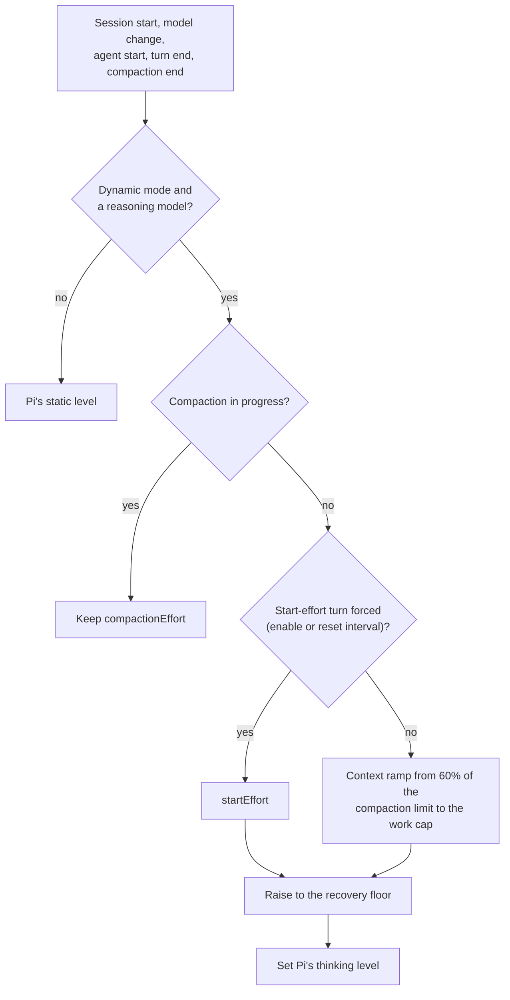
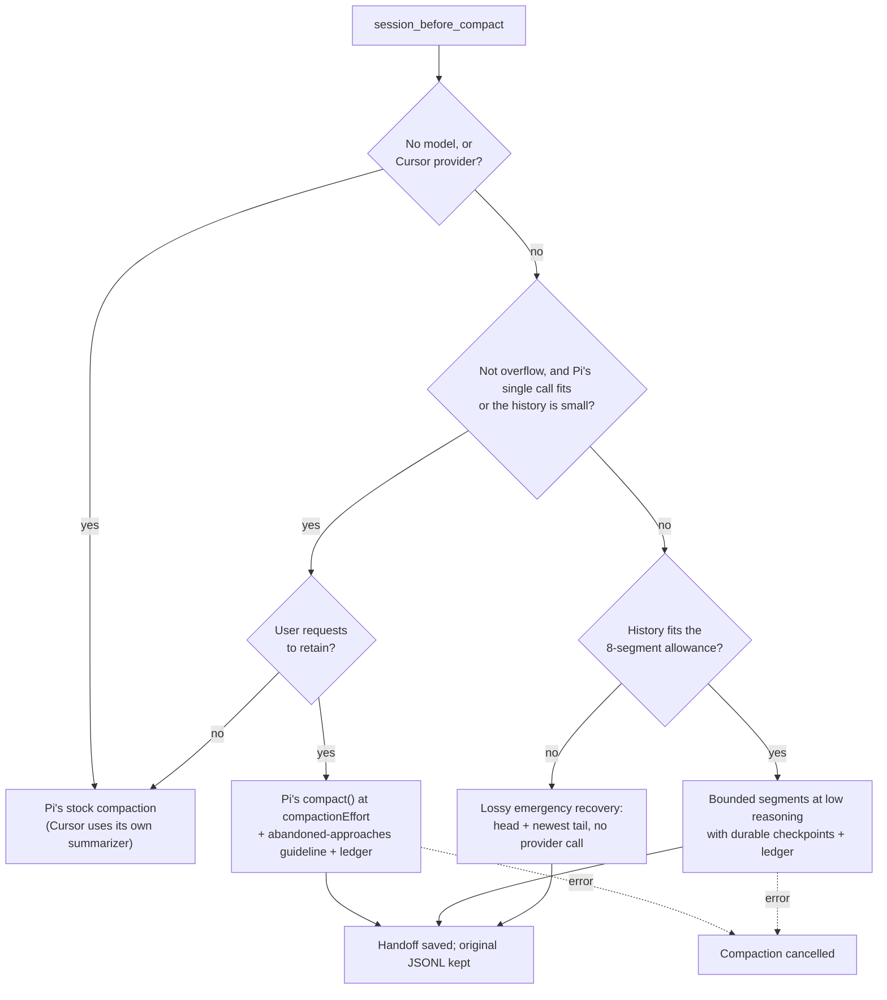
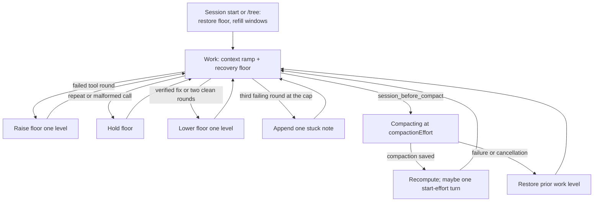

# Pi effort manager

[日本語](README-ja.md)

Repository-owned Pi package for dynamic reasoning-effort management. It extends Pi's standard
static effort controls and has no runtime dependency on the former third-party package.
The SDK compatibility baseline is Pi 1.0.4; local dependencies and peer requirements are aligned
with its normalized transcript APIs. Run `bun install` here and reload/restart Pi after updating.

**Defaults.** Dynamic mode is off unless `dynamicDefault` is `true` in the settings (a session's
persisted state and the `--dynamic-effort on|off` flag take precedence). Progress text is off
unless `progressTextOnCompaction` or `progressTextOnEffortChange` is explicitly `true`. The
bounded compaction guard is a separate extension and is always loaded.

## Controls

Pi's standard controls remain authoritative for static effort selection:

- `Shift+Tab` cycles effort levels.
- `--thinking <level>` selects the initial level.
- `defaultThinkingLevel` configures Pi's default level.

This package does not redefine those controls. Its additional controls are:

- `/fast [on|off]` controls the priority service tier for GPT-5 models on the `openai`,
  `openai-codex` and `azure-openai-responses` providers. It is saved in the global settings.
- `/dynamic-effort on|off|status` (no argument means `status`).
- `/dynamic-effort start <level|default>`, or its alias `/dynamic-effort min <level|default>`,
  sets the minimum work effort.
- `/dynamic-effort end <level|default>` sets the work cap.
- `/dynamic-effort compact <level|default>`, or its alias `compaction`, sets the compaction effort.
- `/dynamic-effort reset-effort <level|default>`
- `/dynamic-effort reset <positive-integer|default>`
- `Ctrl+Shift+E` is the sole package-defined shortcut and toggles dynamic mode for the session.
  `Ctrl+Shift+D` is reserved by Pi's TUI for writing `pi-debug.log`.
- `--dynamic-effort on|off` overrides the restored/default mode.

`start|min|end|compact|compaction|reset-effort|reset` create session-local overrides; `default`
clears one. Changing `reset-effort` or `reset` also clears the qualifying compaction count. Turning
dynamic mode on forces one start-effort turn.

## Effort selection

Dynamic mode discovers supported levels from the active Pi model (Pi's levels are `minimal`, `low`,
`medium`, `high`, `xhigh`, `max`). Provider-equivalent mapped levels are deduplicated. Three
boundaries shape the range:

- **Minimum effort:** `startEffort` (`medium` by default). Work effort never drops below it.
- **Work cap:** `endEffort` (by default the second-deepest supported level). The deepest level is
  kept for compaction.
- **Compaction effort:** `compactionEffort` (by default the deepest supported level).

A configured boundary the model does not support resolves to the next deeper supported level, or to
the default when there is none. If the start lies above the cap, work uses the start level only.
A single-level model uses that level for both work and compaction. Models without reasoning stay
unchanged.



The compaction limit is the context window minus `compaction.reserveTokens` (16,384 when unset).
Up to `rampStartRatio` (0.6) of that limit the start level is used; above it the remaining range
is divided evenly across the work levels up to the cap.

At `session_before_compact` the controller saves the current work level and sets Pi's level to the
compaction effort. After a successful compaction it recalculates from the current context usage. A
compaction counts toward the reset interval only when its pre-compaction level is at least
`compactionResetEffort` (`xhigh` by default); every `compactionResetInterval` qualifying compactions
(1 by default) force one start-effort turn. A failed compaction restores the saved work level.

## Recovery floor

Dynamic work effort also has an evidence-based recovery floor, counted in levels above the start.
Each completed tool round is classified (`src/recovery-effort.ts`):

| Round                                                                                                                | Effect on the floor     |
| -------------------------------------------------------------------------------------------------------------------- | ----------------------- |
| At least one failure (`isError` and not malformed); several in one round count once                                  | Raise one level         |
| A repeat: same tool, same arguments (without the free-text `description`) and same output as one of the last 8 calls | Hold (no decay)         |
| A malformed call: Pi's `Validation failed for tool …` or `Tool "x" not found`                                        | Hold                    |
| A verified fix: a call whose input failed earlier succeeds, with no failure in the round                             | Lower one level at once |
| Two consecutive clean rounds                                                                                         | Lower one level         |
| Empty round, a turn already counted, or no reasoning profile                                                         | Nothing                 |

A repeat holds instead of raising because polling a long job, such as tmux check-ins, repeats too.
A malformed call needs a corrected call rather than deeper reasoning; stronger reasoning increases
tool hallucination[^reasoningtrap]. The floor is capped at the number of work levels minus one, so
pressure never exceeds what the levels can express. The effective level is the deeper of the floor
and the context ramp. The floor is persisted in a branch-local session entry only when it moves.

**Stuck note.** When three failing rounds in a row happen at the work cap, the first failing tool
result of the third round receives one appended text note: the approach has failed for several rounds at the
highest work effort, so state the blocker and try a different approach or ask the person. The note
is given once and re-armed after a non-failing round.

**Signatures.** A call is identified by the tool name, its arguments JSON as length plus first and
last 512 characters, and its result as length plus first and last 256 characters, so a long input
or output that differs in the middle is not taken for a repeat. On resume both windows (recent calls
and failed inputs) are refilled from the tool results in the last 64 messages of the branch. The
floor itself is restored from the persisted entry and is not recounted. Resume recomputes the level
from context instead of forcing the start effort, and never triggers a compaction.

## Design evidence

Every benefit below comes from the cited studies; none was measured for this package, which has not
been evaluated on a task benchmark. The thresholds are heuristics, not a trained router[^ares]; log
per-level reasoning and outcomes before tuning them.

| Mechanism                                                         | Evidence                                                                                                                                                                                                                                                                                                                                       | Risk it avoids                                                          |
| ----------------------------------------------------------------- | ---------------------------------------------------------------------------------------------------------------------------------------------------------------------------------------------------------------------------------------------------------------------------------------------------------------------------------------------- | ----------------------------------------------------------------------- |
| Per-step effort instead of one fixed level                        | Running every agent step at low effort lost nearly 20% accuracy, while per-step selection matched fixed high effort with up to 52.7% fewer reasoning tokens[^ares]. Difficulty-adaptive compute was over 4x more efficient than best-of-N[^snell]; learning when to think cut response length by 53% and raised accuracy by 2.4%[^adaptthink]. | A fixed level wastes reasoning on routine steps or fails the hard ones. |
| Less overthinking: `medium` start, cap below the deepest level    | More reasoning correlated with fewer resolved agentic tasks; two low-effort attempts reached 27.3% against 29.1% for high effort at 43% lower cost[^overthinking]. Simple problems receive excessive compute[^chen], and more test-time compute can lower accuracy[^inverse].                                                                  | Extra cost and lower accuracy from excess reasoning.                    |
| Context ramp                                                      | Accuracy degrades as input grows[^contextrot].                                                                                                                                                                                                                                                                                                 | Long sessions running at the same effort as the first step.             |
| Raise on tool failures                                            | Failure feedback improves agents[^reflexion]; error-correcting and re-planning steps need the most effort[^ares].                                                                                                                                                                                                                              | Too little reasoning at critical steps.                                 |
| Only external evidence counts                                     | Self-correction without external feedback can make answers worse[^huang].                                                                                                                                                                                                                                                                      | Effort driven by the model's own text.                                  |
| Hold on repeats and malformed calls                               | Step repetition is a frequent failure mode[^mast]; stronger reasoning amplifies tool hallucination[^reasoningtrap].                                                                                                                                                                                                                            | Raising effort for polling, or for a call that only needs correcting.   |
| Lower at once on a verified fix; decay after clean rounds         | Reasoning can stop once a trial answer is confident[^deer]; execution feedback verifies a fix[^selfdebug].                                                                                                                                                                                                                                     | Holding a raised level after recovery[^overthinking].                   |
| Stuck note at the cap                                             | Thinking longer on one path stops paying[^mirage]; failed agent runs consume far more resources than successful ones[^sweeffi].                                                                                                                                                                                                                | Burning the deepest work effort on an approach that keeps failing.      |
| Abandoned approaches kept in summaries                            | Losing what failed invites repeating it[^mast]; naming what a compression must keep preserves accuracy at fewer tokens[^acon].                                                                                                                                                                                                                 | Repeating failed approaches after compaction.                           |
| Minimum effort stays at `medium` by default, not the lowest level | Too small a reasoning budget can cost more tokens, not fewer (token elasticity)[^tale].                                                                                                                                                                                                                                                        | Extra tokens and lost accuracy from starting too low.                   |

## Bounded compaction guard

The package also loads `src/context-guard.ts` as an independent safety extension on
`session_before_compact`. Original JSONL history is never rewritten; for full requests and tool
output, consult the preserved session (`/session`).

### Routing



The native path is used when the reason is not overflow and either:

- Pi's single-call compaction fits: the history to summarize (`tokensBefore - keepRecentTokens`) is
  at most four times Pi's summary output cap (`min(0.8 * reserveTokens, maxTokens)`), and that
  history plus `max(reserveTokens, maxTokens)` plus 4,096 prompt tokens fits the context window; or
- the window is at least 8,192 tokens and the serialized text is under half the bounded input budget.

On the native path the guard calls Pi's own `compact()` with the level Pi is at, which the
controller has already set to the compaction effort. It previously passed no level, so native
summaries ran without reasoning; that is fixed. It also appends the abandoned-approaches guideline
after the person's `/compact` focus, and appends the user-request ledger to the result. When no user
requests remain to retain, the guard steps aside and Pi's stock compaction runs unchanged, without
the guideline. Cursor always keeps its own summarizer, which appends the same ledger.

The ledger keeps the original user requests separately from the generated summary, as Codex does:
newest first within 20,000 UTF-8 bytes (an eighth of smaller windows), each request clipped at 4,000
bytes on code-point boundaries with the omitted middle marked.

### Bounded segments

Overflow recovery and the remaining oversized histories are summarized in sequential segments with
the selected model and its existing credentials. The previous summary, split-turn prefix and user
focus are included; the retained-message boundary and file-operation metadata are preserved. Limits:

- Input budget: half the context window in UTF-8 bytes, at most 96,000 bytes (a window too small
  for 4,096 bytes cancels).
- Each segment carries up to a third of that budget of history; the running summary is bounded to a
  quarter of it, and the prompt asks for at most 1,500 characters including abandoned approaches.
- Output cap: `min(8192, maxTokens, contextWindow / 8)` tokens.
- Reasoning `low`, prompt caching disabled, a fresh session ID per compaction, provider retries 6.
- Usage of successful calls is accumulated.

### Failure handling

| Outcome                                                       | Handling                                                                             |
| ------------------------------------------------------------- | ------------------------------------------------------------------------------------ |
| Abort, or a non-transient provider error                      | Cancel compaction; never fall back to the same oversized request or partial history. |
| Connection drop (`terminated`, `Connection error`, …)         | Retry the same segment, up to 3 attempts, then cancel.                               |
| `length` stop (max-output truncation)                         | Keep the text and bound it.                                                          |
| Thinking without text                                         | Keep the thinking as the segment summary.                                            |
| Content-free segment                                          | Leave the running summary untouched; cancel only if the whole summary is empty.      |
| Overlong summary (for example Devin emitting tool renderings) | Trim to the segment budget on a code-point boundary and mark it truncated.           |

### Emergency recovery

Histories larger than the 8-segment allowance enter **lossy emergency recovery** rather than
cancelling. The guard selects the beginning (one quarter) and the newest tail (three quarters) of an
eight-segment character budget without allocating code-point arrays or splitting surrogate pairs.
If that selection still exceeds the byte budget, its middle is trimmed (a quarter head, the rest
tail), so multibyte history keeps its newest tail. The handoff is saved immediately with no provider
call. The UI warns and the summary permanently records the omission. This is not a failure, but the
gap is not evidence that missing work was completed; consult the original session.

### Provider notes

- Requests for `opencode`/`opencode-go` models, or models pointing at `opencode.ai`, send
  `x-opencode-session`, `x-opencode-client` and `User-Agent: pi-coding-agent`. Extension model calls
  bypass Pi's provider runner, and OpenCode rejects requests without a session (`MissingSessionID`).
  Other providers' headers are left alone.
- OpenCode Go declares 1M-token windows, and Pi's four-characters-per-token estimate undercounts
  Japanese-heavy history. `.pi/agent/models.json` therefore lowers each `opencode-go` window (about
  60% of the catalog) and caps output at 65,536 tokens.
- The guard bounds work; it cannot guarantee success for incorrect model metadata, provider failures
  or oversized retained recent messages.

### Durable checkpoints

- Bounded summarization checkpoints each successful segment with `@earendil-works/pi-durable` 1.0.4
  in `<session.jsonl>.effort-durable/` (fsync, exclusive lock). Non-persistent sessions stay in memory.
- A checkpoint holds the next segment, the bounded running summary and accumulated usage; a retry of
  the same compaction reuses committed segments, including a completed one Pi did not record.
- Reuse requires an exact hash of the serialized input, model, context window, retained-entry
  boundary and checkpoint version; changed inputs start fresh.
- Only the final complete handoff is returned to Pi. A call that finished before its checkpoint was
  committed may run again; reused usage is counted once.
- Reopening a journal never starts model calls or tools by itself. Lock, journal and checkpoint
  errors cancel compaction. The journal holds private summary text beside the session.

### Operator recovery

The repository's global settings reserve 65,536 tokens for compaction and keep 12,000 recent tokens;
project settings take precedence, and models with small windows should use a smaller project
reserve. For a failed session, first `/loop pause` and `/goal pause`, then `/compact`; resume
scheduling only after it succeeds. If bounded recovery fails, use `/tree` to an earlier safe point or
`/new` with a concise handoff. Do not repeatedly send `continue`.

## Harness transitions and ownership

The extensions share Pi's request/tool lifecycle instead of starting a second agent runner. The
graph below describes enforced transitions, not an LLM-generated execution plan:



- Goal owns the objective and completion audit. Loop/tmux own their wakeups and process
  notifications; effort never queues work, declares completion, or resumes stopped automation.
- Effort changes alone are not evidence of task progress.
- Repeated compaction starts preserve the original work level. A success or failure consumes the
  pending transition once; a late success cannot reset effort after a failure. Model selection
  discards the pending compaction transition.
- Recovery state and its last processed turn ID are recorded in branch-local session entries, so a
  repeated delivery of the last turn does not count twice. `/tree` restores the selected branch and
  clears pending progress messages; it does not import another branch's transient state.

Offline integration coverage lives in `../pi-goal-extension/smoke.mjs` and
`../pi-goal-extension/recovery-smoke.mjs`: they load goal, loop, tmux, dynamic effort and the
compaction guard together with a fake provider and no network access. They establish lifecycle
behavior; they do not measure live-model instruction-following quality.

## Status

`/dynamic-effort status` prints:

```text
dynamic=on effort=high start=medium end=xhigh compact=max reset=1@xhigh context=91000/400000 compactions=0 levels=minimal, low, medium, high, xhigh, max reasoning(avg/max)=medium:812/2040 recoverySteps=1
```

- `dynamic`, `effort`: mode and Pi's current level.
- `start`, `end`, `compact`: resolved minimum, work cap and compaction effort.
- `reset=N@level`: reset interval and reset effort.
- `context`: context tokens / context window.
- `compactions`: qualifying compaction count.
- `levels`: supported levels.
- `reasoning(avg/max)`: observed reasoning tokens per level, when the provider reports
  `usage.reasoning`.
- `recoverySteps`: the recovery floor.

The status bar and working message show the level and add `dynamic` while automatic control is active.

## Progress text

Progress text is model-authored rather than emitted as fixed notifications. When enabled, an effort
change or a successful compaction gives the next model call one private, one-shot opportunity to
write a brief update, through a transient system message in `context_with_system`. It never adds a
synthetic user request or replaces the system prompt; existing instructions take precedence. Both
triggers are opt-in: only an explicit `true` enables one.

## Settings

Optional values live under `pi-effort-manager` in global `~/.pi/agent/settings.json` or trusted
project `.pi/settings.json` (project values win). The extension also reads `compaction.reserveTokens`.
Defaults when omitted:

| Key                          | Default                   |
| ---------------------------- | ------------------------- |
| `dynamicDefault`             | `false`                   |
| `startEffort`                | `medium`                  |
| `endEffort`                  | second-deepest supported  |
| `compactionEffort`           | deepest supported         |
| `compactionResetEffort`      | `xhigh`                   |
| `compactionResetInterval`    | `1`                       |
| `fastMode`                   | `false`                   |
| `progressTextOnCompaction`   | `false`                   |
| `progressTextOnEffortChange` | `false`                   |
| `rampStartRatio`             | `0.6` (clamped to 0–0.95) |

This repository's global settings enable everything explicitly:

```json
{
  "pi-effort-manager": {
    "dynamicDefault": true,
    "startEffort": "medium",
    "endEffort": "xhigh",
    "compactionEffort": "max",
    "compactionResetEffort": "xhigh",
    "compactionResetInterval": 1,
    "progressTextOnCompaction": true,
    "progressTextOnEffortChange": true,
    "rampStartRatio": 0.6
  }
}
```

State changes are recorded as session custom entries, so resume and branching do not share a mutable
process-global controller.

## References

[^ares]: _Ares: Adaptive Reasoning Effort Selection for Efficient LLM Agents_ (2026). arXiv:2603.07915. <https://arxiv.org/abs/2603.07915>

[^snell]: Snell, C., Lee, J., Xu, K., & Kumar, A. (2024). _Scaling LLM Test-Time Compute Optimally can be More Effective than Scaling Model Parameters_. arXiv:2408.03314. <https://arxiv.org/abs/2408.03314>

[^reflexion]: Shinn, N., Cassano, F., Berman, E., Gopinath, A., Narasimhan, K., & Yao, S. (2023). _Reflexion: Language Agents with Verbal Reinforcement Learning_. NeurIPS 2023. arXiv:2303.11366. <https://arxiv.org/abs/2303.11366>

[^mast]: Cemri, M., et al. (2025). _Why Do Multi-Agent LLM Systems Fail?_ arXiv:2503.13657. <https://arxiv.org/abs/2503.13657>

[^contextrot]: Hong, K., Troynikov, A., & Huber, J. (2025). _Context Rot: How Increasing Input Tokens Impacts LLM Performance_. Chroma technical report. <https://research.trychroma.com/context-rot>

[^overthinking]: Cuadron, A., et al. (2025). _The Danger of Overthinking: Examining the Reasoning-Action Dilemma in Agentic Tasks_. arXiv:2502.08235. <https://arxiv.org/abs/2502.08235>

[^inverse]: Gema, A. P., et al. (2025). _Inverse Scaling in Test-Time Compute_. arXiv:2507.14417. <https://arxiv.org/abs/2507.14417>

[^huang]: Huang, J., Chen, X., Mishra, S., Zheng, H. S., Yu, A. W., Song, X., & Zhou, D. (2024). _Large Language Models Cannot Self-Correct Reasoning Yet_. ICLR 2024. arXiv:2310.01798. <https://arxiv.org/abs/2310.01798>

[^adaptthink]: Zhang, J., Lin, N., Hou, L., Feng, L., & Li, J. (2025). _AdaptThink: Reasoning Models Can Learn When to Think_. arXiv:2505.13417. <https://arxiv.org/abs/2505.13417>

[^chen]: Chen, X., et al. (2024). _Do NOT Think That Much for 2+3=? On the Overthinking of o1-Like LLMs_. arXiv:2412.21187. <https://arxiv.org/abs/2412.21187>

[^acon]: Kang, M., et al. (2025). _ACON: Optimizing Context Compression for Long-horizon LLM Agents_. arXiv:2510.00615. <https://arxiv.org/abs/2510.00615>

[^tale]: Han, T., et al. (2024). _Token-Budget-Aware LLM Reasoning_. arXiv:2412.18547. <https://arxiv.org/abs/2412.18547>

[^selfdebug]: Chen, X., et al. (2023). _Teaching Large Language Models to Self-Debug_. arXiv:2304.05128. <https://arxiv.org/abs/2304.05128>

[^deer]: Yang, C., et al. (2025). _Dynamic Early Exit in Reasoning Models_. arXiv:2504.15895. <https://arxiv.org/abs/2504.15895>

[^mirage]: Ghosal, S. S., et al. (2025). _Does Thinking More Always Help? Mirage of Test-Time Scaling in Reasoning Models_. arXiv:2506.04210. <https://arxiv.org/abs/2506.04210>

[^reasoningtrap]: Yin, C., et al. (2025). _The Reasoning Trap: How Enhancing LLM Reasoning Amplifies Tool Hallucination_. arXiv:2510.22977. <https://arxiv.org/abs/2510.22977>

[^sweeffi]: Fan, Z., et al. (2025). _SWE-Effi: Re-Evaluating Software AI Agent System Effectiveness Under Resource Constraints_. arXiv:2509.09853. <https://arxiv.org/abs/2509.09853>
